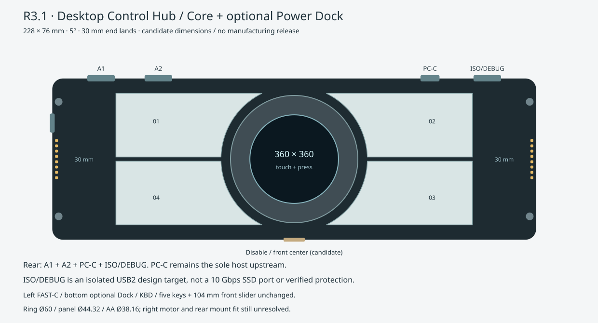
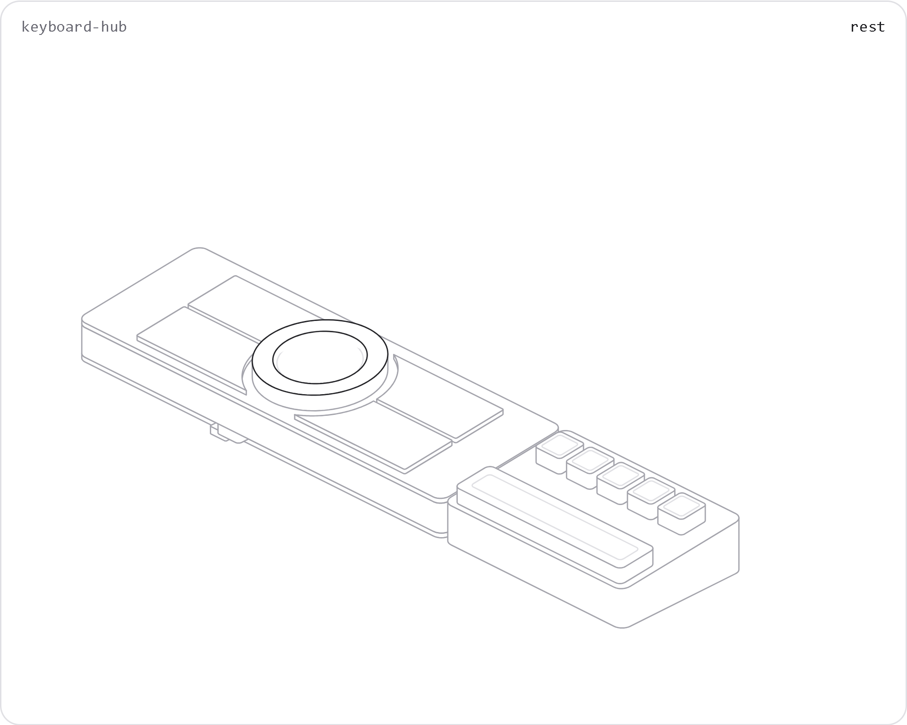

# Keyboard as PC Hub

**Desktop Control Hub · R3.1：Core＋可选下置Power Dock＋低功耗MAG附件。**

Core背部PC-C是唯一电脑上行，单线从电脑允许的VBUS预算取电，目标为不依赖Dock即可使用主体与键盘。Hub硬件转发USB外设数据，ESP32负责圆屏、旋钮、四键、音频和HID；Hub启动不应依赖ESP32固件。单线功耗、Hub配置与故障独立性尚未通过整机验证。

[最新交接基准](docs/R3_1_CODEX_HANDOFF.md) · [差异与决策台账](docs/R3_1_DECISIONS.md) · [WP1/WP2工程评审](docs/R3_1_ENGINEERING_REVIEW.md) · [下一步入口](CODEX_START.md)

[补充讨论采用/放弃清单](docs/R3_1_SUPPLEMENT.md)：保留五键与104mm前部横条，补强Hub启动和Slider验证，早期双向供电/竖条/第二上行不混入当前设计。

**新增设计决定：[最右侧 ISO／DEBUG USB-A](docs/iso-debug-r3-1.md)。** PC-C候选中心移至X≈+64，ISO口X≈+91；由P6经独立USB2双下游Hub保留CTRL并增设隔离调试链路。首版采用隔离电源、集成限流/短路/防反灌保护、数据ESD和本地故障指示；精确计量留作后续选装。[候选材料表](hardware/electronics/iso-debug-candidate-bom.csv)不等于采购或保护能力认证。

[原理图摆位表](docs/iso-debug-schematic-placement-r3-1.md) · [A3摆位视图](design/drawings/iso-debug-schematic-placement-r3-1.svg) · [首版功能连接参考](design/drawings/iso-debug-minimal-schematic-r3-1.svg) · [Anatomy结构视图](design/visualization/iso-debug-anatomy.html) · [预览图](design/visualization/iso-debug-anatomy-preview.png)。当前仅确定原理图页内位置，未画导线或PCB；现有KiCad主工程尚未写入该页。

## 当前结构与接口

| 部位 | R3.1分工 |
| --- | --- |
| Core背部 | A1、A2、PC-C、最右侧ISO／DEBUG USB-A；PC-C唯一电脑上行，无Core POWER输入 |
| Core左侧 | FAST-C，目标10Gbps下游；实际供电按预算，不预先承诺3A |
| KBD / CTRL | 可调Type-C键盘公头 / 内部ESP32 USB2 Full-Speed HID |
| Core底部 | P4 Dock DATA＋独立PWR/CTRL预留，封装与开孔未定 |
| 可选下置Dock | Rev B：扩展Hub、外部PD受电、保护降压、单向给Core供电；没有第二电脑上行 |
| 两端MAG | 低速、低功耗8触点；五键及前部唯一横向触控条，不传高速USB/全机电流 |

逻辑下游P1=A1、P2=A2、P3=FAST、P4=DOCK、P5=KBD、P6=USB2分支至原CTRL与新ISO／DEBUG；这是架构分配，不是芯片物理引脚。USB7206C仍为候选，尚未证明Core单线工作能力。旧A3迁为Dock数据链路，POWER IN移至Dock；旧100W/46W单体预算仅保留为历史。

| 尺寸 | 候选值，mm |
| --- | --- |
| Core / PCB | 228×76、5°，前20/后26.65；PCB216×64×1.6 |
| 短四键 | 四片镜像，外端X=±84，两端各留30固定壳面；键面高0.3 |
| 感应中心 | (±65,±18)，保持原位 |
| 环 / 屏 / AA | Ø60 / Ø44.32 / Ø38.16；单边可见边框1.8 |
| 五键 / 横条 | 112×76一字五键；前部横条104×22×8，目标有效长90～96 |
| 底部Dock研究区 | 48×18功能区；8板间距和20高Dock包络均未冻结 |

新增[左右马达预留与PCB布局](hardware/pcb/references/core-haptic-placement-r3-1.md)：2026-10-22锁定[iPhone 7 Plus Taptic Engine](docs/haptic-iphone-7-plus.md)，按用户给定含耳50×12.5×2.6 mm设计，每侧装配区改为15×54×6 mm、长边沿Y，两端顶面保持完整留白。接线采用六测试焊盘最外侧两点接独立触觉驱动；[本轮原生执行记录](hardware/pcb/references/haptic-7plus-native-update.md)与[10月19日历史板图/DRC](hardware/pcb/exports/core-r3-1-haptic-study/README.md)分开保存。新板尚未接网/布线，不能打样。

## 原HTML持续更新

[原单文件HTML](design/visualization/hairline-keyboard-hub.html) · [使用与截图](design/visualization/README.md)。下载后离线打开；悬停主体展开、点击固定/复位，右侧五键及横条磁吸拆分。可选Dock只在主体展开时显示研究包络；默认Core不装Dock。GitHub README仅显示静态图。

[底部接口与侧剖](design/drawings/dock-interface-r3-1.svg) · [R3.1机械说明](hardware/enclosure/dimensions-r3-1.md) · [端口选型表](hardware/electronics/dock-port-selection.csv)

[ISO口与右马达、后孔空间关系](design/drawings/iso-debug-rear-study-r3-1.svg)：这是候选二维研究，开孔仍未冻结。

## 实物进展与文件分类

已运行主体：圆屏、触控页面、触摸板、USB键鼠/媒体HID、四键、按压输入、编码器与提示音；[实测历史](docs/body-core-bringup.md)保留原文。Touchpad延迟本轮不改。新增[INMP441代码](docs/microphone-inmp441.md)只编译，默认关闭，未接实物。输入按压通过不代表屏幕Z轴机械机构已完成。

| 分类 | 入口 | 状态 |
| --- | --- | --- |
| 固件 | [firmware](firmware/README.md) | 保留已运行GPIO与整合代码，本轮不改动/烧录 |
| 展示与图纸 | [design](design/README.md) | 原HTML、R3.1俯视/底视/剖面示意 |
| 机械 | [hardware/enclosure](hardware/enclosure/README.md) | R3.1参数/草模，未实体编译与装配验证 |
| PCB | [hardware/pcb](hardware/pcb/README.md) | 新增指定工程的R3.1布局草案与马达预留；未接网/布线，DRC未通过；R3载板保留历史 |
| 接口与接线 | [hardware/electronics](hardware/electronics/README.md) | 新接口目标与既有实物分开记录 |
| 镜像与证据 | [releases](releases/README.md)、[tests](tests/README.md) | 保留原镜像、许可和真实日志 |

尚未完成电源/Hub/Dock电路、连接器冻结、ERC、USB合规、闭壳温升或制造放行。新增布局已运行DRC但未通过；完整原理图与电气连接仍待完成。不做第二上行、双向大电流、手机高压PD输出、读卡、电池或竖触控条。

[目录规则](docs/repository-layout.md) · [本轮检查](tests/design/r3-1-review.md) · [R3历史尺寸](hardware/enclosure/dimensions-r3.md) · [旧单体供电方案](docs/desktop-power-dock.md) · [R2历史](hardware/enclosure/dimensions-r2.md)
