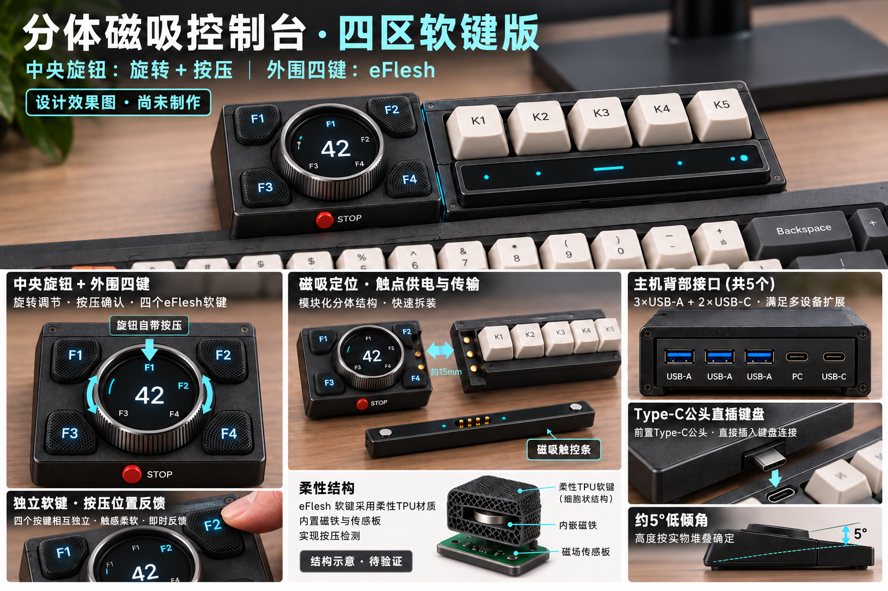

# Keyboard as PC Hub

**实施入口（2026-10-13）：** [从设计走向实现](docs/project-start.md) · [下一阶段任务](CODEX_START.md)。

**产品定位：键盘联接式桌面供电与控制底座（Desktop Power & Control Dock）。** 独立外部供电，为键盘与桌面外设汇聚数据和供电，圆屏/旋钮负责操作。主机独立落桌承力，键盘通过可调 Type-C 公头接入；右侧磁吸五键与触控条保持独立。

[最新定位与Hub/插头选型](docs/desktop-power-dock.md)：POWER IN按100W等级PD受电预留，PC为10Gbps电脑上行，FAST为10Gbps外设口；保持背部3A+2C、侧面FAST。100W输入不等于已验证100W输出，也不自动给电脑充电。基础版为低压USB供电，无市电插座。

## 文件分类

后续直接在 `main` 上继续优化。文件按用途分开存放：

| 分类 | 入口 | 内容 |
| --- | --- | --- |
| 固件代码 | [firmware](firmware/README.md) | 当前 ESP32-S3 工程、GPIO 诊断工程、历史代码 |
| 设计图与展示 | [design](design/README.md) | 布局图、概念图、历史 PDF、交互 HTML |
| PCB 设计 | [hardware/pcb](hardware/pcb/README.md) | R3 KiCad 接口载板草稿；尚未布线与制造验证 |
| 外壳设计 | [hardware/enclosure](hardware/enclosure/README.md) | R3 尺寸、参数化 OpenSCAD 草模与后续导出目录 |
| 电气接线 | [hardware/electronics](hardware/electronics/README.md) | 实物模块与接线说明 |
| 烧录包 | [releases](releases/README.md) | 镜像、构建配置、校验清单和恢复方法 |
| 测试证据 | [tests](tests/README.md) | 原始实物测试日志 |
| 规划与记录 | [docs](docs/repository-layout.md) | 功能规划、兼容性研究、验收说明与目录规则 |

目录规则及旧路径对应关系见[仓库目录规范](docs/repository-layout.md)。

## 当前进展

**主体固件进展（2026-10-17）：** 圆屏、触控页面、触摸板、USB 键鼠/媒体控制、四键、按压、旋转及提示音已整合。旋转双向事件和 Windows HID 枚举已验证，用户在原生 USB 下复测后确认所有功能正常。Touchpad 刷新率和延迟保留为后续优化项。参见[实测记录](docs/body-core-bringup.md)、[固件源码](firmware/body-core)及[烧录镜像](releases/body-core/README.md)。Hub、磁吸附件和 eFlesh 不在本轮范围内。

**当前设计 R3：参考 Nape Pro 的横向布局，去掉 M1/M2，主体四键镜像对称。中央改为旋钮触摸屏，保留磁吸五键、触控条、触点和键盘公头位置。** R2 左小右长方案保留为历史；现有实物接线不随新外壳规划移动。

新增 [INMP441 麦克风方案与代码](docs/microphone-inmp441.md)：采用独立 I²S1，默认关闭，已做两种配置的编译检查；本轮未连接或烧录实测麦克风。

## 交互结构展示

[下载／查看单文件HTML](design/visualization/hairline-keyboard-hub.html) · [使用方法与检查记录](design/visualization/README.md)

[主体功能详细展示（结构、连接、信号流、软件模块、验收阶段）](design/visualization/body-core-showcase.html)

下载HTML后直接用浏览器打开，无需安装。悬停主机看分层；点击固定，再点同处或空白复位。悬停右侧五键或触控条看磁吸分离。滑块改变展示间距，`play`自动导览。GitHub README只显示静态图，不运行HTML交互。

## 当前尺寸

| 项目 | 布局候选，mm |
| --- | --- |
| 主机外壳 | 228×76；5°；前高20、后高26.65（不含突出控件） |
| 主 PCB | 216×64×1.6；模块接口载板草稿，未布线 |
| 旋转环／屏体／有效区 | Ø60／Ø44.32／Ø38.16 |
| 环开口／可见边框 | Ø41.76／单边1.8 |
| 四键感应中心 | R3 新布局：(−65,+18)、(+65,+18)、(+65,−18)、(−65,−18) |
| 左右键面 | 四片镜像等面积，中央避让R34.5；外端X=±84，左右各留30 mm固定壳面 |
| 主体四软键外露高度 | 目标0.3，基本齐平；右侧五个机械键保持原高度 |
| 右侧附件／拼合占地 | 112×76／341×76，均为展示包络 |
| 两端磁吸触点 | 每端8点、间距2.5；两枚Ø5磁体，电气保护待设计 |

**R3 尚未制造放行。** KiCad 草稿可编辑，但没有走线、ERC/DRC 结果或 Gerber；OpenSCAD 草模尚未进行实体编译和装配验证。已通过的主体固件实物测试与这些新结构草案分别记录。

## 详细资料

1. [R3结构、坐标和尺寸](hardware/enclosure/dimensions-r3.md)：当前机械候选及未核实项目；[R2](hardware/enclosure/dimensions-r2.md) 为历史。
2. [键盘接口兼容性研究](docs/keyboard-compatibility.md)：公开端口资料、可调公头与主板尺寸边界。
3. [接口与供电](docs/ports-and-power.md)：背部3A＋PC-C＋POWER-C、左侧FAST-C、键盘公头。
4. [已有硬件与GPIO](hardware/electronics/current-wiring.md)：保留用户11个GPIO分配。
5. [功能、散件验证及单板集成](docs/product-and-integration.md)。
6. [接口调查表](hardware/pcb/references/keyboard-port-survey.csv)与[R3机械参数](hardware/enclosure/interface-parameters-r3.json)。
7. [R3 PCB接口工程](hardware/pcb/sources/body-r3/README.md)、[OpenSCAD草模](hardware/enclosure/sources/body-r3.scad)及[检查记录](tests/design/README.md)。
8. [端口与插头采购约束表](hardware/electronics/dock-port-selection.csv)：上行、PD受电、数据下游、键盘公头与磁吸接口分别选型。

主机使用现有N16R8、360×360圆形触控屏、MAX98357A及扬声器。外围四块eFlesh软键、五宏键和触控条可配置；独立视觉节点识别手势，经ESP-NOW传输。高速数据走独立Hub，ESP32作为下游HID；FAST与其他外设共享上行带宽。

## 历史资料

以上旧效果图不代表R2键面、接口标识或制造尺寸。[R0结构](hardware/enclosure/dimensions-r0.md)、`design/drawings/history/`、`firmware/legacy/functions/`、`firmware/legacy/stm32f103c8t6/`均保留作历史参考；原示例不是当前ESP32固件。[此前首页](docs/history/README-before-2026-10-09.md)保留原始思路。
