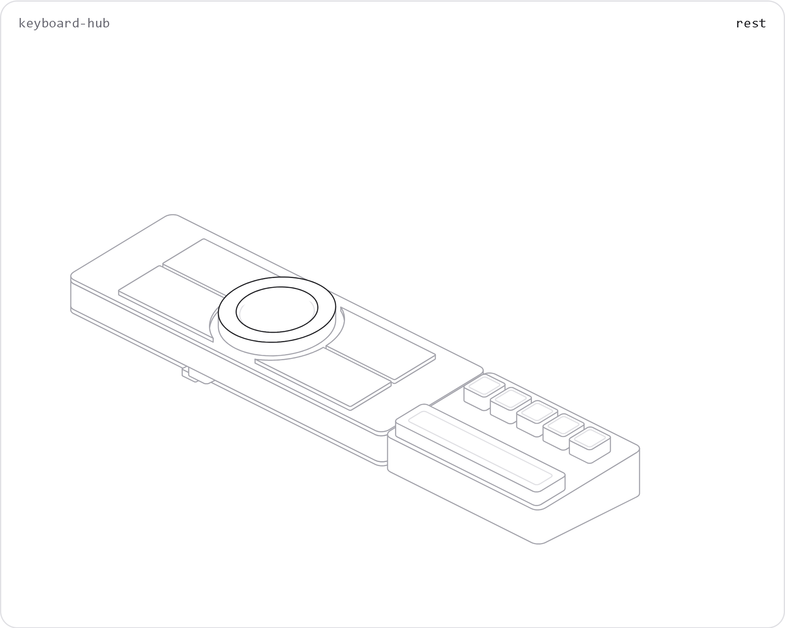
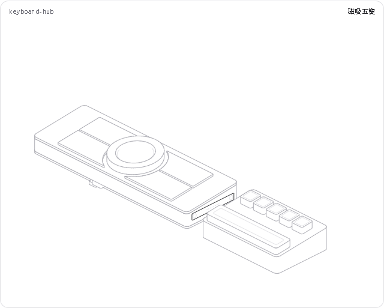
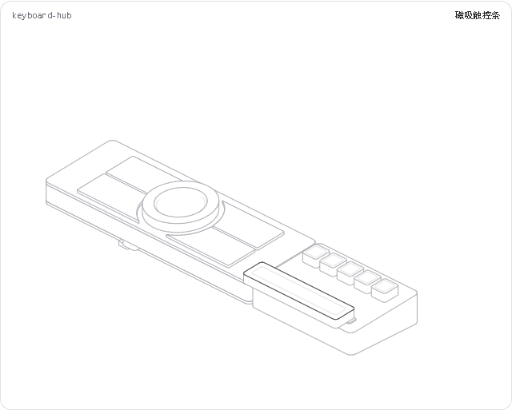

# 原 Hairline HTML：更新至 R3

当前产品定位为[键盘联接式桌面供电与控制底座](../../docs/desktop-power-dock.md)，原HTML继续展示相同结构和交互；端口电气功能以新选型文档为准，不把图形预留视为已实现PD或Hub。

[原HTML入口](hairline-keyboard-hub.html)及[原绘图源码](keyboard-hub.js)直接更新，没有另建 R3 展示入口。原有分层、点击固定、磁吸拆分和导览继续使用。历史 R2 可从 Git 历史和[尺寸文档](../../hardware/enclosure/dimensions-r2.md)查看。



## 本次结构修改

- 主体228×76 mm、5°，中央Ø60旋转环包围Ø44.32圆屏，四个凹弧长键镜像对称；去掉参考外观中的M1/M2。
- 2026-10-18缩短四键：外端由X=±108收至±84，每键内收24 mm，主体两端各留30 mm固定壳面；屏幕、感应中心、触点与五键模块保持原位。
- 主体四键高出面板0.3 mm，保留1 mm上限；右侧五个机械键仍高出9 mm。
- 右侧五键模块112×76 mm，触控条独立拆离。两端各保留8触点与磁铁位置，键盘公头独立承载。
- 展开后显示屏幕托架、三点支撑、感应模块、PCB、麦克风与扬声器声腔包络。
- 展开不改变屏幕与感应模块的平面位置；屏幕不跟随外环旋转。

完整尺寸见[R3机械说明](../../hardware/enclosure/dimensions-r3.md)，电路见[PCB工程](../../hardware/pcb/sources/body-r3/README.md)。Hub、声腔、磁吸及支撑仍为结构候选，图形不作为制造文件或实物通过记录。

## 交互

悬停主体展开；悬停圆屏突出托架；悬停五键模块向右分离，悬停触控条向前、上方分离。点击固定，再点同处或空白复位。滑块仅改变展示分离距离8/16/24 mm。`play`按主机→托架→磁吸五键→触控条→装配导览。





单文件离线打开；GitHub README显示静态图。页面与引擎使用hairline-create原始bench/kernel。主要遵循固定命中区、局部响应、单处高亮、实体遮挡、静止停帧、统一生命周期、圆角轮廓及图内无文字规则。

## 重建与检查

将技能路径赋给`HAIRLINE_SKILL`，在本目录运行：

```powershell
node "$env:HAIRLINE_SKILL/build.mjs" keyboard-hub.js
node "$env:HAIRLINE_SKILL/validate.mjs" hairline-keyboard-hub.html
node "$env:HAIRLINE_SKILL/look.mjs" keyboard-hub.js --answer 0,0,31 --edge 110,35,24 --zoom rest
node check-interactions.cjs
```

`HAIRLINE_LOOK_CACHE`指向仓库外包含`node_modules/playwright-core`的缓存；需有本机Chrome。浏览器和Node是检查工具，打开HTML不需要这些依赖。

本次通过：八状态取景/读数/控制台、四键等面积与凹弧、中心固定、固定/复位、两种磁吸分离、四区域的滑块两端、导览、play、减少动态效果、离线加载及销毁。源码125行。已目检装配、分层、小尺寸、主题与动画过程；240px下触点不作为可读尺寸图。

[八状态](hairline-keyboard-hub-look.png) · [小尺寸盲图](hairline-keyboard-hub-blind.png) · [动画过程](hairline-keyboard-hub-motion.png) · [工程检查记录](../../tests/design/README.md)
