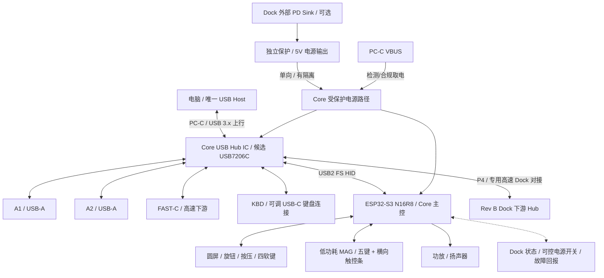

# Keyboard as PC Hub — R3.1 Codex 工程交接 / 实施基准

> 交接版本：R3.1 / 2026-10-19  
> 目标仓库：`https://github.com/Invovel/Keyboard_as_PC-Hub`  
> 建议仓库内路径：`docs/R3_1_CODEX_HANDOFF.md`  
> 状态：**需求与接口架构基准，不是制造放行、器件封装冻结、已验收 PCB。**  
> 本文件以本轮用户最终确认的需求为架构目标；现有仓库（当前读取的 `main`）作为历史实测和代码基准。两者冲突时应识别并提交变更计划，不应假定旧 README 已同步。

## 0. Codex 先执行这些规则

1. **先读再改**：依次检查 `README.md`、`firmware/body-core/README.md`、`docs/body-core-bringup.md`、`hardware/electronics/current-wiring.md`、`hardware/enclosure/dimensions-r3.md`、`hardware/pcb/sources/body-r3/README.md`、`docs/ports-and-power.md`、`docs/desktop-power-dock.md`，并对照实际源码与 KiCad / OpenSCAD 文件。
2. **保留已验证工作**：不要重排现有运行 GPIO、替换屏幕驱动初始化表、覆盖 USB HID 实测固件或删除旧 R0/R2/R3 历史。涉及 GPIO 调整必须先报告冲突及实测依据。
3. **只把已验证的写作“通过”**。接口预留、原理图草稿、模块测试、整体运行、制造验证是不同等级；没有 Gerber、ERC/DRC、真实叠装与闭壳测试就不能写“可量产”。
4. **不要直接下单或生成可制造宣称**。先统一文档与机械/电源/高速信号接口约束，再布局、计算、验证。不要猜测模组针距、屏幕 FPC、USB-C 与 Dock 连接器封装。
5. **禁止默默扩大范围**：不做第二电脑上行、USB 上行动态双选、双向供电、电池、手机 PD 快充、读卡器、右端竖向触控条等当前排除事项。
6. 修改时分开“设计基准/候选值/待定/实测记录”，记录对应文件和变更原因。不要为了统一措辞改写真实测试日志。

## 1. 产品定义与优先级

**对外名称：Desktop Control Hub；项目/仓库代号：Keyboard as PC Hub。**

Core 是桌面 USB 控制中枢：**唯一电脑上行线连接 Core 的 PC-C；Core 可独立工作；用户的圆屏、旋钮、四软键控制体验优先；USB Hub 硬件负责标准外设的数据转发。**

用户明确要求：

- 主体可独立接电脑工作，不依赖磁吸五键、触控条或 Power Dock。
- 键盘优先通过可调 USB-C 公头接入，附件/线束不对键盘母口施加壳体承力；设备本身落桌承力。
- Core 的数据上行 **始终、仅** 在主体背部 PC-C；Dock 没有第二条电脑上行，拆装 Dock 不改变 Core 的控制权。
- 鼠标接收器、耳机、U 盘/SSD 等作为 USB 外设直连 Hub，不经过 ESP32 软件转发；ESP32 是交互/附件/管理中心，并作为 Hub 的内部 USB HID 下游。
- Core 单线运行默认从电脑 VBUS 取得允许的电力；Dock 是 Rev B 可选下置供电和外设扩展，向 Core **单向**供电。禁止两路 5V 直接硬并联或外部供电反灌电脑。
- 主控的软件/GUI 故障不应成为基础 USB 键盘及普通外设工作的必经单点故障；具体独立启动和故障隔离需要设计、实测。
- 操作体验优先于充电功率；不能将旧版 100W 输入、46W 5V 总预算用于声明 Core 单线工作能力。

### 明确不做（本轮）

- Dock 或五键附件充当电脑上行；切换 Core/Dock 两个 PC-C 上行；两个 USB Host 的并联。
- Core↔Dock 双向大电流供电；普通八点 MAG 用作高速 USB 或大功率接口。
- Core 内置 20V PD 输入；Power Dock 的手机高压 PD 输出、读卡、电池、大功率交流插座。
- 竖向、双位置触控条；改变五键原结构；新增 M1/M2。
- 独立视觉识别节点整合进 Core（XIAO ESP32-S3 Sense 保持独立，ESP-NOW 事件输入仅长期规划）。

## 2. 总体架构（功能和物理层）



逻辑约束：

- USB7206C 是**当前六下游候选**，不是已购买、已验证或强制唯一型号。先验证是否满足 Core 单线总线供电、尺寸、启动、散热和 10Gbps 布线限制。
- Hub 应能在 ESP32 固件失败时完成必要的独立初始化；不应仅靠 ESP32 I²C 启动命令才能枚举基础外设。配置方式以所选芯片数据手册实证为准。
- Dock 端口的数据必须通过 Core Hub 的真实 USB 下游链路进入电脑；Dock CTRL 的 I²C/UART 仅负责管理，不替代 USB D+/D− 与 SuperSpeed 差分链路。
- Core 需要 USB-C 上游受电角色、CC 和 SuperSpeed 翻转/复用、ESD 与 USB 数据完整设计；不能只把芯片的 Type-B 参考板接口换成 Type-C 外壳。
- Dock 部分若使用第二颗 Hub，则是 **Hub 级联**，不是增加第二上行。共享上游带宽，扩展 SSD 并发性能须验证。

## 3. Core R3.1 布局（最新目标）

### 3.1 外形与坐标

基于仓库 R3 外壳草模，**以下是候选尺寸，不是已测装配数据**：

| 项目 | R3.1 目标/候选 | 备注 |
|---|---|---|
| 外壳 | 228 × 76 mm，R5；约 5° 倾斜 | 前高约 20、后高约 26.65 mm |
| 主 PCB 轮廓 | 216 × 64 × 1.6 mm | 现为接口载板草稿，不含真实 Hub/原生 MCU 成品布局 |
| 屏幕中心 | (0, 0)，X 向右，Y 向背面，Z 向上 | 外壳 X ±114，Y ±38 |
| 外环 / 屏体 / 显示有效区 | Ø60 / Ø44.32 / Ø38.16 mm | 圆屏固定不随环转；机械尺寸需实测 |
| 主体四软键 | (−65,+18)、(+65,+18)、(+65,−18)、(−65,−18) | 镜像布置，四键保留 |
| 左右两端留白 | 每端约 30 mm | 固定壳面，非竖触控条安装位 |
| 主 PCB 旧安装孔 | (±104,±28)，Ø2.4 mm | 现 R3 结构候选，勿与新增 Dock 区冲突 |
| 中央按压 | 屏幕沿 Z 独立按压，触发行程目标 0.3 mm、硬限位目标 0.6 mm | **未完成机构验证** |
| 磁吸端面 | X=±114，每端 8 触点，间距 2.5 mm | 低压低速，端面小板仍需设计 |

### 3.2 Core 外部端口

**先冻结功能位置，不冻结焊盘坐标或封装型号。**

| 区域 | 接口 | R3.1 布置 / 目标 |
|---|---|---|
| 背部 | A1 | USB-A 3.x，下游；X≈−91 mm（原 R3 候选） |
| 背部 | A2 | USB-A 3.x，下游；X≈−64 mm（原 R3 候选） |
| 背部 | PC-C | **唯一电脑上行 USB-C**；X≈+91 mm（候选） |
| 左端中后部 | FAST-C | USB-C 10Gbps 目标；Y≈+17 mm（候选） |
| 独立可调件 | KBD | USB2 键盘连接公头/短线可调结构；承力不经过键盘母口 |
| 右侧端面 | MAG-R | 五键 + 前侧横向触控条附件 |
| 左侧端面 | MAG-L | 同标准的低功耗附件预留，注意与 FAST 口间距 |
| 主体底部（后侧优先） | DOCK | 高速 USB DATA + 受保护 PWR + CTRL，**具体位点/连接器待定** |
| 前侧 | 总禁用、可选麦克风孔、扬声器声腔 | 固定壳体，避免中央活动机构；精确坐标待验证 |

**旧版必须移出 Core 的接口**：A3（改为 Dock 逻辑数据通道），POWER IN-C（移至 Rev B Dock）。现有 `hardware/enclosure/dimensions-r3.md`、端口 CSV、OpenSCAD、布局 SVG 仍写着旧位置，需在新修订中统一，不能直接以旧图为完成布局。

### 3.3 Core PCB 的器件分区（只是功能分区）

```text
                背面 Y+  [ A1 ] [ A2 ]                    [ PC-C ]
            ┌────────────────────────────────────────────────────┐
 FAST-C ←   │      USB Hub 区 / 高速接口走线约束                    │
 (左侧)     │                                                     │
            │   F1                 固定圆屏/旋转环               F2 │
 MAG-L ←    │             中央机械避让区：旋转 + 独立按压             │ → MAG-R
            │   F4                                             F3 │
            │    Mic（可选）   ESP32/3.3V/调试区   I²S 功放/扬声器   │
            └────────────────────────────────────────────────────┘
                      前面 Y−  [总禁用键]
            底面：Dock 连接器（PWR / DATA / CTRL）+ 结构定位
```

- 中央区域优先保证屏幕、旋转环、轴承/传动、排线和独立按压行程。**不得简单将普通 EC11 实心轴中心定在 (0,0) 与屏幕叠放**。仅可冻结同心旋转轴线；编码器本体可研究侧置传动或环形检测。
- Hub 暂放中部偏左，ESP32 暂放中部偏右，麦克风左前，功放右前；**不是最终元件坐标**。USB 高速线可走性、ESP32 模组天线净空、电源和 3D 机械干涉决定最终位置。
- 屏幕连接器必须以实物尺寸、针序、线束或 FPC 结构定义，不能把逻辑网络直接等同于模块真实插头脚位。
- 两端 MAG、磁体、旧固定孔、左侧 FAST 与 Dock 接口均需做 3D 干涉核对。

## 4. Core USB Hub 端口映射（六个逻辑下游）

| 逻辑端口 | 功能 | 目标速率/注意 |
|---|---|---|
| P1 | A1 | USB3.x，实际受供电预算约束 |
| P2 | A2 | USB3.x；与 2.4GHz 无线接收器干扰布局需测试 |
| P3 | FAST-C | USB 10Gbps 目标，CC Source/方向翻转/独立端口保护 |
| P4 | DOCK DATA | 为 Rev B 下置 Dock 预留的 USB3.x 下游；Dock 缺席时空置 |
| P5 | KBD | 仅使用 USB2 通道的键盘接口 |
| P6 | CTRL | ESP32-S3 原生 USB Full-Speed HID |

**这是逻辑 P1–P6 的分配，不是 USB7206C 物理管脚编号或已确认的硅片端口属性表。** Codex 必须核查选定芯片物理下游口的 SuperSpeed/USB2 组合约束、供电和配置方式，再建立网络映射；不可凭序号直接出板。

- FAST 与 A1/A2/Dock 所有高速设备共享 PC-C 上行带宽；不承诺每口独享 10Gbps。
- 鼠标、耳机的 USB2/无线链路不通过 ESP32；低延迟须与电脑直连做实测对比，不承诺零延迟。
- 高速 USB3 SSD 与 2.4GHz 接收器应在空间、电缆和屏蔽上隔离，避免无线干扰。

## 5. Core 已有 ESP32 固件/电气基准

**以 `firmware/body-core/README.md` 与真实运行源码、日志为准。** 现有实物：ESP32-S3 N16R8 开发板、TK015F5785_PB 360×360 QSPI 圆屏及 I²C 触控、MAX98357A、扬声器、GPIO Extension Board。最终原生 PCB 与开发板载板是不同阶段。

| 功能 | GPIO | 状态与备注 |
|---|---|---|
| LCD QSPI | CS16, SCLK6, D0=15, D1=7, D2=11, D3=12 | 已有整合固件 |
| 触控 I²C | SDA8, SCL9 | 当前地址 0x15；无独立 INT/RST 线 |
| 软键/测试实体键①②③④ | 42, 41, 40, 38 | 四键硬件现有逻辑；eFlesh 传感替换尚未完成 |
| 编码器 A/B | 1 / 2 | 双路与正反转事件已按运行源码记录验证；物理线标曾有矛盾，布板前再次实物核对 |
| 独立按压输入 | 39 | 当前输入能工作，**不代表屏幕的独立 Z 轴按压机构已完成** |
| MAX98357A | BCLK47, WS48, DIN21 | 5V 功放；扬声器 OUT+/OUT− 不能接系统 GND |
| INMP441 可选麦克风 | BCLK4, WS5, SD17 | 仅编译/接口预留，未实物测试；默认关闭 |
| 禁用输入 | GPIO0 / BOOT | 当前总禁用操作功能；新板需考虑启动绑定位与独立实体键 |
| 原生 USB HID | D− GPIO19 / D+ GPIO20 | 键盘、鼠标、媒体 HID；不是高速 USB Host |
| MAG DET/INT | GPIO18 / 10（载板草稿预留） | 未接通；核对和 GPIO 冲突后方可冻结 |

- ESP32-S3 以 N16R8 能力为目标；最终 WROOM 模组/天线版本、3.3V 稳压、去耦、EN/BOOT、USB ESD、烧录和调试路径仍需要原理图设计。
- Hub 的真实电源轨（包括可能的低压核心电源）、电流和上电时序，以 **最终 Hub 芯片官方 datasheet** 为准，不能假设仅有 5V 就能运行。
- 保留已有 360×360 UI、原生 HID、旋钮、提示音、NVS、触摸板功能；触摸板刷新率/延迟优化为独立事项，不应在转 PCB 工作中无故改变行为。
- 当前主体基础功能由用户实测确认；它**不**证明磁吸、eFlesh、Hub、Power Dock、闭壳、量产已经完成。

## 6. 五键 + 横向触控条（不改变旧附件关系）

- 右侧附件机械候选包络 112×76 mm；五个机械键，键距 19.05 mm；K5 作为 Fn/功能层键，保留原布局（**不要再绘制新的 3+2 或竖触控结构来代替真实设计**）。
- 触控条 **只有一个当前安装位**：五键模块前部，横向。原尺寸候选 `104×22×8 mm`，有效触摸长度目标 `90–96 mm`；不要将其移到 Core 右端留白。
- 首版优先 **电容线性 Slider**，输出连续触摸位置（而非将触控条做成固定几个机械按键）。默认相对滑动；按住 Fn 可选绝对位置/第二控制层；主体圆屏显示反馈。
- MCP23017（I²C GPIO 扩展，五键）和 AT42QT2160 类 I²C Slider 控制器是**候选**。必须核对数据手册、具体电极数量与尺寸、I²C 地址、中断工作方式，特别验证 90–96mm 长电极的定位线性度和手势。
- MAG-R 低功耗 8 触点候选：受保护 5V、GND、隔离/受控 3.3V、SDA、SCL、DET、INT、GND。左右同地址附件并用时需独立总线段或地址隔离方案；磁吸热插拔、ESD、电源限流、防反接均待设计。
- 五键先验证，随后加入触控条。右端竖向位置和双位置复用**推迟**，不要为此改变 Core 现有端面和孔位。

## 7. 可选 Power Dock（Rev B，仅预留完整接口框架）

- **机械**：放在 Core 下方，顶视尺寸与 Core 相当是候选而非确认；需单独核算叠装高度、倾角、定位件、散热、开孔和插拔受力。
- **数据**：Core Hub 的 P4 → 高速 Dock 专用板对板 DATA 连接器 → Dock 下游 Hub → Dock 的 USB 外设。Dock 没有外接电脑的第二上行口。
- **供电**：Dock 可接外部 USB-C PD Sink，从适配器协商后降压输出受保护 5V，**单向**向 Core 供电。电脑 VBUS 仅按其供电能力为 Core 提供默认电源；两个输入禁止直接并联/反灌。
- **控制**：Dock 通过独立 CTRL 通道回报连接、电源、电流、过流、温度和状态，Core ESP32 圆屏显示并可执行允许的策略；保护动作必须硬件自主完成。
- **连接器逻辑分区**：`PWR`（额定电流的电源+GND+检测）、`DATA`（USB2 D±、SuperSpeed TX/RX 差分对、地回流/屏蔽）、`CTRL`（I²C/UART、DET、INT）。可物理分件，或选有完整规格的一体组件。**不得用原八点 MAG 传 USB 10Gbps 或全机大电流。**
- **Dock Rev B 基本功能**：额外 USB 端口、PD 受电与电源分配、状态回报。手机高压 PD 快充、读卡器、电池和第二上行不在基本版。
- **强制先决**：Rev A PCB 布局冻结前，必须明确 Dock 接口封装/高度/结构避让和高速信号性能；Rev B 再实现 Dock 电路。
- **预算**：旧版 `9.2A/46W`、`100W PD 输入` 是旧单体规划，不再作为 R3.1 Core 或 Dock 的确定输出规格。先测 Core 自身功耗，再分别计算电脑单线和 Dock 增强模式的端口电流上限。
- **电源策略**：总线供电与自供电状态涉及 USB 枚举/报告/供电规则；接拔 Dock 不保证无感或存储不掉线。不要许诺 SSD 写入过程中可无中断切换电源；必须先有过流、反灌和掉电保护。

## 8. 软件职责边界

| 子系统 | 所属处理器/通路 | 目标 |
|---|---|---|
| 键盘、鼠标接收器、U 盘数据 | 独立 USB Hub → 电脑 Host | 不经 ESP32；不把 I²C 当 USB 数据通道 |
| UI、屏幕触控、旋钮、四键 | ESP32-S3 | 配置/宏/媒体与 HID |
| 磁吸五键、Slider | MAG I²C/INT → ESP32 | 模块识别、热插拔、统一输入事件、断开时释放按键 |
| 音频 | ESP32 I²S → MAX98357A / 可选 I²S Mic | 短提示音，Mic 默认关闭 |
| Hub 管理 / 电源管理 | 专用控制与保护芯片 + ESP32 | 硬件先保证安全，ESP32 只显示/设置允许的管理功能 |
| 桌面状态 | 可选电脑端软件 | 只有在 USB 协议/主机软件真实回传时显示应用/音量/媒体状态 |

## 9. 工作包与交付物（Codex 按依赖顺序）

### WP0 — 资料同步与差异审查（先做，非硬件制造）

- [ ] 核对本文件与 `main` 的差异，先给出涉及文件列表与冲突；旧 README / `desktop-power-dock.md` / `ports-and-power.md` 仍是旧版“主件自带 PD + 背部 3A+2C”描述。
- [ ] 更新 README 产品定位为 `Desktop Control Hub / Core + 可选 Power Dock + MAG 附件`，明确 `A3 → DOCK`、`POWER IN → Dock`。
- [ ] 将结构图/端口表的旧 A3/POWER IN 坐标标为历史或更新为 R3.1；保留 R3 原始文档记录和 R2/R0 历史。
- [ ] 所有 README 文档链接使用仓库相对路径；不要使用 `claude.ai/chat/...` 类临时页面作为源码文档链接。
- [ ] 生成 `R3_1_DECISIONS.md` 或本文件中的决策台账，列出冻结与待定项目。

### WP1 — Rev A 系统电气设计

- [ ] Core 总线供电、USB-C CC/角色、ESD、Hub 独立启动/复位、额外电源轨与控制方式的原理图；**先测供电并验证 USB 供电合规性**。
- [ ] ESP32-S3 原生模组主控、电源、EN/BOOT、USB HID、烧录、复位、测试点；保留现有运行 GPIO。
- [ ] USB7206C 候选与替代选型评估：真实端口映射、单线电流、芯片功耗/热量、10Gbps 线路损耗、量产可采购性和参考布局。
- [ ] 各下游端口独立开关/限流/过流检测；Hub 启动不依赖 ESP32 可靠运行。
- [ ] 设计 Rev B Dock 的 PWR/DATA/CTRL 对接规格，并绘制空位和机械剖面，不能只画无尺寸的文字标签。

### WP2 — Rev A 机械、PCB 与装配核对

- [ ] 核对 R3 228×76 外壳、216×64 PCB、中央环/屏/Z 行程、USB 插口真实 3D 封装、FAST 与左 MAG 干涉、底部 Dock 和固定孔。
- [ ] 定义中央实际旋钮传动/编码器布局，避免 EC11 实心轴占据屏幕空间。
- [ ] KiCad 真实电气网络/封装/走线、高速差分与回流路径、电源完整性/射频天线区、ERC/DRC；输出设计评审，而非未经验证的制造放行。
- [ ] OpenSCAD/CAD 结构更新：顶视/底视/侧剖/装配状态，尺寸实测与候选清楚标注。

### WP3 — 实物验证与附件

- [ ] Core 只有电脑一根线：测功耗、可用端口功率、USB 枚举、按键 HID、圆屏、旋钮与提示音。
- [ ] 测 ESP32 重启、固件失败时键盘/USB 外设维持通信的能力；真实独立性由日志证明。
- [ ] 分别测试 FAST/USB3 SSD、无线接收器、并发吞吐、输入延迟、无线抗干扰、长时间温升、睡眠/恢复与断电行为。
- [ ] 测五键的 Fn 功能及 Slider 的连续位置、相对滑动、热插拔、断开键释放；地址冲突与总线隔离。
- [ ] Rev B Dock 再做 PD、供电、扩展 Hub、状态监控、叠装测试；不在 Rev A 宣称已完成。

## 10. 接受标准与证据要求

最低交付要求（只评价**真实执行过**的内容）：

- 每份新电气/机械资料能追溯到真实器件、尺寸、数据手册及仓库文件；未定项列 TBD。
- 不改变现有固件的 GPIO 逻辑，除非出具引脚冲突清单并有明确用户批准及回归测试。
- Rev A：Core 无 Dock 时正确上电、USB Host 可枚举 Hub+ESP32+键盘、圆屏和四键输入可用；总线供电电流遵守已识别的上游限制。
- 基础 USB Hub 与 ESP32 应独立启动；验证 ESP32 故障不会导致主通路必然断开。
- USB 数据测量：直连 vs Hub 键鼠延迟、USB3 吞吐/接收器干扰、并发、休眠重连，实测记录，严禁臆造 0ms 延迟或 10Gbps 实际传输率。
- Dock 缺席：P4 不影响 Core 其他接口；Dock 接入：新增端口可经 Core 上行枚举，电源/反灌/保护行为由仪器验证。
- 高速 PCB：验证差分阻抗、布局、回流、连接器额定与实际眼图/合规需求；ERC/DRC 不等于 USB3 信号完整性或生产可靠性通过。
- 输出完整设计审查后，方可进行打样；生产资料必须有版本号、BOM、Gerber、钻孔、装配和测试计划。

## 11. 尚未冻结 / 需要决策的项目

1. Hub 主方案是否最终使用 USB7206C，以及总线供电下实际能否在有限空间和功率内满足 Core 目标。
2. USB-C、USB-A、Dock 高速板对板、可调键盘公头的实际料号、封装/贴装面和高度。
3. Core 上的真实元件坐标（上一轮图纸只是功能分区）。
4. 中央旋钮选择侧置 EC11 传动还是环形磁/光学检测；屏幕独立按压机构的具体导向和弹性方案。
5. 四个 eFlesh 的传感器、前端和标定方案；现有机械按键仅为输入验证，不自动替代软键终态。
6. 麦克风是否实装 Rev A；当前仅编译和接口预留。
7. 左侧 FAST 与 MAG-L 的实际物理净空，是否禁用左侧实装附件。
8. 五键+横向触控条：触控 IC、电极尺寸、触摸分辨率与实际 104×22×8 包络验证。
9. 单线供电与 Dock 供电的 Hub 配置策略、工作功率上限及掉电切换是否需要重新枚举。
10. Rev A 是否先以外部现成 Hub 功能台架验证，再制造 USB7206C 子板（不改变最终六下游逻辑目标）。

## 12. 重要文件导航（以仓库为基准）

| 文件 | 用途 / 优先级 |
|---|---|
| [`README.md`](../README.md) | 首页；当前 GitHub `main` 被读到的是旧定位，需审慎迁移 |
| [`firmware/body-core/README.md`](../firmware/body-core/README.md) | 当前最可信的固件功能与 GPIO 基准 |
| [`docs/body-core-bringup.md`](body-core-bringup.md) | 真实串口和用户实测记录；保留历史前后状态 |
| [`hardware/electronics/current-wiring.md`](../hardware/electronics/current-wiring.md) | 原连接器/电压/11个已用 GPIO |
| [`hardware/enclosure/dimensions-r3.md`](../hardware/enclosure/dimensions-r3.md) | 原 R3 尺寸、孔、端面触点与结构候选 |
| [`hardware/enclosure/interface-parameters-r3.json`](../hardware/enclosure/interface-parameters-r3.json) | 参数化外壳数据，当前旧端口参数须与新方案对比 |
| [`hardware/pcb/sources/body-r3/README.md`](../hardware/pcb/sources/body-r3/README.md) | KiCad 载板草稿说明，不是 Rev A 原生 PCB |
| [`hardware/pcb/sources/body-r3/generate.py`](../hardware/pcb/sources/body-r3/generate.py) | 会重新生成旧参数/图纸；未更新前切勿直接运行覆盖 R3.1 产物 |
| [`docs/ports-and-power.md`](ports-and-power.md) | 旧单体接口/供电，需按 Core + Dock 修订 |
| [`docs/desktop-power-dock.md`](desktop-power-dock.md) | 旧独立外接电源方案，降为历史/新 Dock 子方案 |
| [`docs/microphone-inmp441.md`](microphone-inmp441.md) | 可选麦克风代码/接口及未实测界限 |
| [`docs/product-and-integration.md`](product-and-integration.md) | 功能清单与模块验收依据，需要按新分工更新引用 |
| [`CODEX_START.md`](../CODEX_START.md) | 现有 Codex 入口；建议添加对本交接文件的引用 |

### Codex 的交付报告格式

每轮修改后简短给出：

1. **变更了哪些文件**（路径 + 主要变更）；
2. **冻结项 / 候选项 / 未定项** 各有哪些变化；
3. **运行过什么检查**（命令、结果和日志路径）；
4. **哪些事情未执行、未测试**；
5. **下一步最小可执行工作包**。

> **最终原则**：只规划一套 Core 唯一电脑上行的架构；Core 用户交互独立，Hub 数据平面独立，Dock 可选且只有下游/单向供电；保留原 R3 结构和已验证固件；所有机械坐标与芯片/连接器的最终规格必须基于真实封装和测量冻结。
