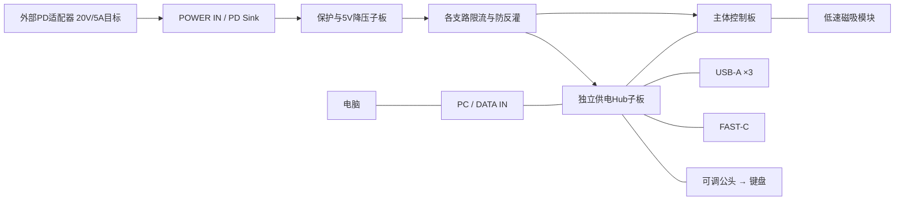

# 产品定位：键盘联接式桌面供电与控制底座

> **R3历史方案（2026-10-18）**。当前R3.1改为Core＋可选下置Power Dock，见[最新决策](R3_1_DECISIONS.md)及[供电/端口](ports-and-power.md)。本文100W/46W和背部3A+POWER仅用于追溯，不作为当前Core或Rev B Dock功率规格。

2026-10-18。项目名和仓库保持 Keyboard_as_PC-Hub；产品定位更新为 **Desktop Power & Control Dock**。它是放在桌面的独立供电、USB 数据汇聚和圆屏操作底座，键盘是接入设备之一。主机独立落桌承力，可调公头只承担键盘连接。主体 R3 外形仍为228×76 mm、5°；四键对称，屏幕触控/按压与外环、磁吸五键和触控条均保留。

当前“桌面电源”指外部适配器供电的低压 USB 配电底座。外壳内不增加交流插座或市电转换；基础版不增加给笔记本充电的 PD 输出。100W 是外部输入选型等级，不是已经验证的总输出、单口充电或给电脑反向供电能力。

## 插头与端口选型结论

接口数量和 R3 位置保持：背部3A+2C、左侧FAST-C、键盘可调公头。具体采购约束见[接口选型表](../hardware/electronics/dock-port-selection.csv)。

| 丝印 | 选择 | 实际分工 |
| --- | --- | --- |
| PC / DATA IN | 24接点USB-C母座，USB 10Gbps通道及对应CC/翻转电路 | 电脑上行；保留VBUS检测，隔离外部电源反灌。与键盘公头不是同一接口 |
| POWER IN | 额定20V/5A的USB-C母座，PD Sink；16接点USB2型或24接点均可，优先带可靠壳脚的板载座 | 外部100W等级适配器输入；没有高速数据，不使用会输出9/12/20V的快充源板代替受电板 |
| FAST / DATA+5V | 24接点USB-C母座，USB 10Gbps，独立限流/过流检测与CC Source宣告 | SSD等高速外设；5V/3A为新设计上限目标，按实际Type-C宣告和功率预算供电，不输出20V |
| A1/A2/A3 | 9接点USB-A 3.x母座，至少5Gbps；采用USB7206C路线时目标10Gbps | 常规外设，每口5V/0.9A预算；不把USB-A口改成只充电口 |
| KBD | USB2数据+5V的完整USB-C下游公头组件，独立可调承载；小板或合规短线组件 | 插入键盘母口；不焊死到大主板，不要求键盘边框对齐。需要正确CC角色及插头翻转连接，不用只有VBUS/GND的充电头 |
| CTRL | 内部USB2连接 | 现有ESP32-S3原生USB HID；保留FTDI调试路径 |
| MAG-L/R | 每端8触点的低速、电源专用磁吸接口 | 五键、触控条等模块；限流、总线隔离与额定电流仍待实现，不承载高速USB或PD电压 |

选择有护壳和应力释放的直头/直角公头，以可调支架匹配键盘；目前不冻结具体弯头朝向或供应商料号。普通无源USB-C母对母延长座、外露高速磁吸头及仅两根供电线的公头不作为本项目接口方案。USB-C的壳体相同不代表数据、PD或电流能力相同。

## Hub选型：独立供电，足够的真实下游口

实际需要 **六个数据下游**：A×3、FAST、KBD、CTRL。POWER IN不是第七个数据口。屏幕、麦克风、按键、编码器和磁吸低速模块接ESP32，不额外消耗Hub下游口。

| 路线 | 具体项目/产品 | 本项目选择与边界 |
| --- | --- | --- |
| 散件整机验证 | StarTech **HB31C5A2CME**，7口自供电USB 10Gbps Hub | 有足够的A/C口做台架连接参考；保留其原配电源、原线和整机，不承诺拆板可塞入R3。采购前核对地区版本、供货、总功率与原配电源 |
| 自制Hub子板 | Microchip **USB7206C**，参考 **EVB-USB7206** | 主线：P1/P2/P3→A口，P4→FAST，P5仅用USB2通道→键盘，P6 USB2→ESP32。高速物理层不能由ESP32软件替代 |
| 四口候选 | VIA **VL822** | 四口版只有4个下游，不能直接满足6路；除非另行设计级联，否则不作为本版单芯片选择 |

USB7206C有五个Gen2下游和一个USB2下游；官方评估板是四层参考板，上行是Gen2 Type-B。它提供的是电气/布局验证依据，不能把评估板Type-B接头简单换壳当成已经完成USB-C CC和翻转设计。[Microchip官方评估板](https://www.microchip.com/en-us/development-tool/EVB-USB7206)、[USB7206C数据手册](https://ww1.microchip.com/downloads/aemDocuments/documents/UNG/ProductDocuments/DataSheets/USB7206C-Data-Sheet-DS00003850.pdf)。

StarTech官方说明7个下游为5A+2C，C口支持最高5V/3A、A口支持BC1.2；这些是产品能力参考，不是本项目实测或允许所有口同时满载的结论。[官方快速指南](https://sgcdn.startech.com/005329/media/sets/HB31C5A2CME_Manual/HB31C5A2CME_QSG.pdf)、[产品页](https://www.startech.com/en-us/usb-hubs/hb31c5a2cme)。VL822的4/2口变体与CC/Mux边界见[VIA官方资料](https://www.via-labs.com/product_show.php?id=99)。

## 电源与模块分工

- 外部输入：选有20V/5A PDO的100W等级成品PD适配器及5A电子标记线；功率仍取决于实际协商。输入控制参考ST **STUSB4500 / EVAL-SCS001V1**；ST官方明确其为最高100W的PD Sink参考设计，不是充电输出或完整的5V降压器。[ST官方资料](https://www.st.com/en/evaluation-tools/eval-scs001v1.html)。
- 5V转换：新设计目标为5V/10A等级并留出温升余量；研究候选为Pololu **D42V110F5**。官方标称5V/11A比较值受输入电压与散热影响，约31.8×43.2×9 mm；不依据标称值承诺本机20V输入及闭壳连续10A。电源板单独布置，不能盖在屏幕托架、麦克风声腔或控制信号排针上。[Pololu官方资料](https://www.pololu.com/product/5671)。
- 每支路另有开关、过流反馈与反向隔离；电源导线/连接器/铜箔不经过GPIO扩展板或细杜邦线承担总电流。保护、测量芯片和量程尚未定型，不在屏幕上伪造电压、电流或瓦数。
- 键盘、ESP32、磁吸附件固定使用受保护5V/3.3V；PD协商得到的20V只留在输入/降压区。USB上行电脑VBUS不与系统5V硬并联。

| 分支 | 5V电流预算 | 功率预算 |
| --- | ---: | ---: |
| A口×3 | 2.7A | 13.5W |
| FAST | 3A | 15W |
| KBD | 1.5A | 7.5W |
| ESP32/屏幕/音频/麦克风 | 1A | 5W |
| Hub与辅助 | 0.5A | 2.5W |
| 磁吸附件预留 | 0.5A | 2.5W |
| 合计 | 9.2A | 46W |

以上为规划预算，端口实际电流仍受枚举/CC宣告、保护和总预算限制。若无法在闭壳实测支持46W负载，应降低FAST或总预算，不以100W适配器代替转换与散热验证。KBD的1.5A是支路设计预留，不自动赋予USB2键盘超枚举取电能力。手机/笔记本的高压PD快充输出需另设Source协议与电源电路，基础版暂不占用现有端口完成它。

## 仓库、结构与验收边界

控制固件、Hub子板、电源子板、磁吸端面小板分别维护。现有[R3控制载板](../hardware/pcb/sources/body-r3/README.md)仍只承载模块接口，J9只接受5V；没有因定位更新就变成100W电源板。板框216×64和外壳228×76保留为候选，电源/Hub实物叠放和热设计未完成；一块现成Hub整机不能按该包络宣称装入。

先完成自供电Hub台架联机和全负载热测，再设计供电/Hub子板与高速布局。验收分别记录：无电脑时供电行为、六路同时枚举、SSD并发吞吐、端口压降/保护、休眠重连和断电恢复。独立供电时能否充电取决于端口Source/充电控制是否实现；当前实物固件不具备这些新电源功能。
