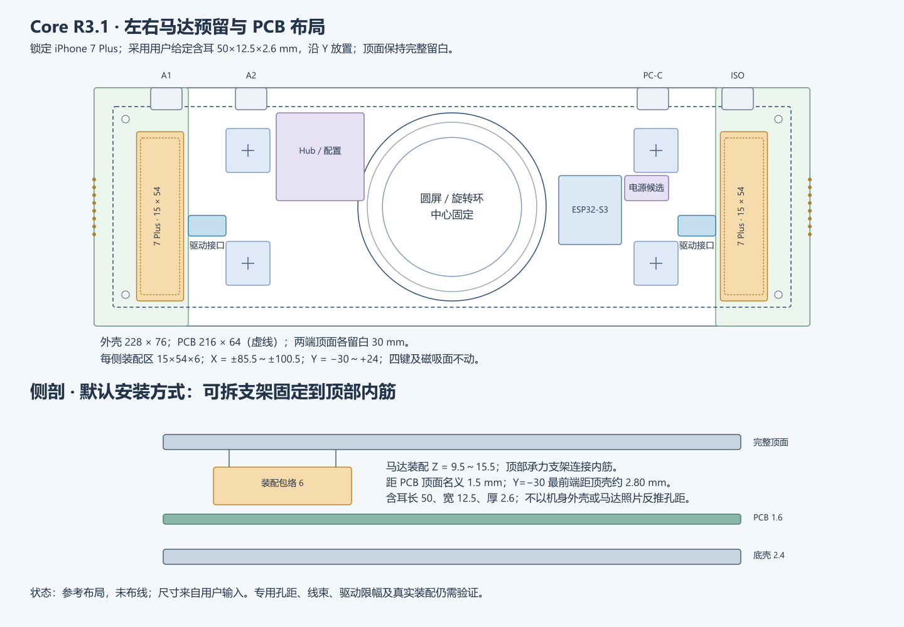

# iPhone 7 Plus Taptic Engine：锁定选型、接线与安装

2026-10-22。用户已锁定 **iPhone 7 Plus Taptic Engine**，取代此前13 Pro/13 Pro Max候选。它只提供按键、触控和旋钮动作的短促反馈，不检测按压，不承担连续扬声器用途。保留既有正常工作的输入及MAX98357A音频代码。

## 尺寸与安装位置

本体43×12.5×2.6 mm、含安装耳50×12.5×2.6 mm、约6.9 g，均采用用户本次提供的设计输入；尚非本项目实测值或Apple尺寸图。按这个输入直接继续设计，不再等待13 Pro商品链接。



| 条目 | 本版设计值，mm |
| --- | --- |
| 产品/主板 | 228×76 / 216×64×1.6；圆屏圆心O不动 |
| 两端顶面留白 | X=−114～−84、+84～+114；表面不新增按键、灯窗或螺钉 |
| 左/右装配区中心 | (−93,−3)、(+93,−3)；马达长边沿产品Y轴 |
| 左装配区 | X=−100.5～−85.5，Y=−30～+24 |
| 右装配区 | X=+85.5～+100.5，Y=−30～+24 |
| 每侧马达及安装件包络 | **15×54×6**，Z=9.5～15.5 |
| 马达含耳名义放置框 | 中心同上；X宽12.5、Y长50，Y=−28～+22 |
| 名义余量 | 左右各1.25，前后各2；总装高度比马达厚度多3.4 |
| PCB/顶部 | PCB顶Z=8；总装距板1.5，前端顶壳内面Z≈18.300，总装顶至内面≈2.800；未扣公差 |
| 固定 | 可拆夹持托片连接顶壳内筋，薄绝缘层和线束应力释放；不在顶面穿孔 |

旧20×36×8区连平面对角线也只有41.18，无法容纳50长的含耳外形，因此作废。新54长槽沿前后方向，不增加整机长度，也不移动圆屏、四个感应中心、MAG端面或五键模块。

首选让**刚性托片/马达安装耳把力传给顶壳内筋**。不把马达悬在软泡棉上，也不把未确认孔距直接画成精确螺孔。托片优先夹住安装耳，不挤压马达薄金属盖。允许薄胶辅助定位，但它的厚度计入6 mm总包络。侧壁固定可作替换支架；板下目前只有4 mm名义净高，不作为默认放置面。安装耳孔距及实际件差异只影响可换托片，不改变锁定型号。

## 公开改装资料与具体接法

[akasaka的7 Plus实作](https://elchika.com/article/2bbe60e0-c923-434e-adc8-8bbf6bb0fd0e/)直接使用本型号：底部黑胶下是一排六个测试焊盘，作者以最外侧两点连接线圈，并报告约175 Hz振动明显。这是单件改装结果，不是Apple额定参数；本项目只采用其焊盘引出路线和调试起点，不照搬直接用MCU引脚供电的做法。

```text
观察揭开黑胶后的六个测试焊盘这一面（不是原机FPC插头）：

   TP-A    ·    ·    ·    ·    TP-B
     │    中间四点绝缘，不连接     │
     │                            │
   OUT+     DRV2605L驱动板        OUT−
             │ VDD / GND
             │ SDA / SCL
          主板JH1或JH2
```

TP-A/TP-B是本项目给两端焊点起的名字，**不是Apple原机针号或官方正负极定义**；两根线接差分驱动输出，均不接GND。原机FPC连接器针序仍不采用。本版不需要购买未知的Apple排线插座，可从这两个测试焊盘引出两根柔软绝缘线，先沿机壳固定并留短弯，再接驱动板。中间四点用聚酰亚胺胶带遮蔽，焊点做独立应力释放，避免牵拉焊盘。原机排线是否保留服从实际件结构，不先裁断未确认走线。

[iFixit原机拆装](https://www.ifixit.com/Guide/iPhone+7+Plus+Taptic+Engine+Replacement/67594)确认该马达原本通过排线连接并以三颗螺钉固定；这里采用可拆托片承力，未复制原手机孔位。

## 主板与驱动接口

采用**DRV2605L直接集成主板**作为电气目标，两侧马达通过各自两针输出座连接；单马达可先装一侧。JH1/JH2保留外接驱动转接/调试用途、默认DNP，不同时将内外驱动输出接到同一个马达。驱动适配仍需实物限幅与温升验证，不能把型号选择当作已完成测试。

| JH1/JH2针号 | 设计职责 | 接入 |
| --- | --- | --- |
| 1 | HAPTIC_3V3_PROTECTED | 受保护3.3V给驱动VDD；不是马达额定电压结论 |
| 2 | GND | 驱动供电地，与主板共地 |
| 3 | SDA_3V3 | 单驱动时接现有GPIO8的I²C总线 |
| 4 | SCL_3V3 | 单驱动时接现有GPIO9的I²C总线 |
| 5 | EN_RESERVED | 为驱动使能预留；MCU引脚未分配，首版转接板本地上拉使能，不能悬空 |
| 6 | NC | 不连接 |

这是**本项目新线束针序**，不表示市售DRV2605L模块的插针顺序；现有板上焊盘仍未接网，不能直接插接通电。JH1/JH2采用六针JST GH候选封装；马达在转接板输出侧另接两根线。

[TI数据表](https://www.ti.com/lit/ds/symlink/drv2605l.pdf)支持LRA、差分输出和I²C地址0x5A。单驱动可与当前0x15触控共享总线，保持3.3V上拉；总线上已有上拉时统一核算，不重复堆叠。双驱动不能直接同时并联到该总线，应在主板侧增加I²C通道复用/隔离，再各接JH1/JH2。

驱动小板依TI典型电路配置VDD和REG的1µF电容，未使用IN/TRIG接地。3.3V是驱动供电基线，**不等于把3.3V直流加在线圈上**。175 Hz仅用于初始共振搜索；线圈阻抗、RATED_VOLTAGE、OD_CLAMP、启动/制动与自动校准尚未实测，不填伪造的出厂值。现有MAX98357A保留，不作为这版默认触觉驱动。

## PCB布局改动与边界

具体坐标见[PCB工作说明](../hardware/pcb/references/core-haptic-placement-r3-1.md)。为长槽避让，JH1/JH2已通过Konnect移到(±78,−6)，JG1/JG2移到(±76.5,+6)；PC/Dock电源选择研究区从右端移到X=55～69、Y=2～10。新电源区14×8只是候选，不代表完整选型已经装得下。感应中心、安装孔、USB外部开口和MAG端面不移动。[主板集成与安装分工](core-integration-and-mounting-rev-a.md)另列完整职责。

名义平面避让：长槽距按键外缘1.5、距端面13.5、距后侧USB研究区3；前孔中心至槽外侧3.5。按当前GH封装，JH与槽间距约1.52、JG约1.77。这不替代实际USB座、线束折弯、磁吸竖板、螺柱、天线及Z层干涉检查。长槽下方PCB保留，但槽内不放高件或向上伸出的焊脚。

本轮不修改固件、不烧录、不改变已通过测试的GPIO。交付的是马达接线设计及布局更新；完整电路、供电预算、接网布线、ERC/DRC和实装验证仍各自保留为后续工作。
