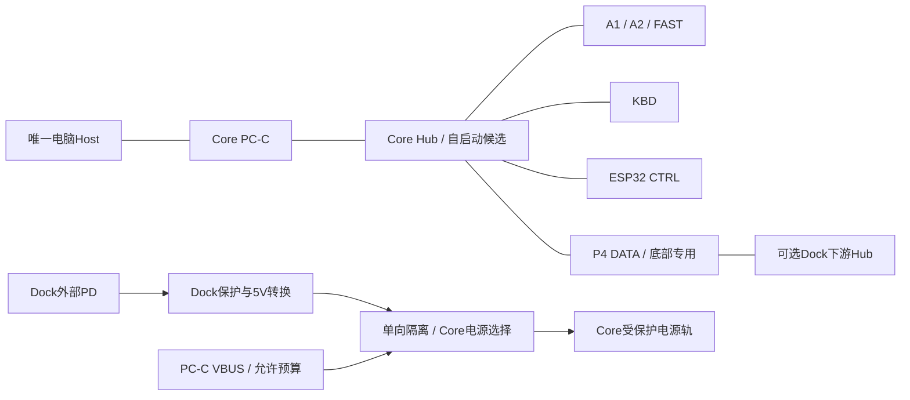

# 当前接口与供电：R3.1 Core＋可选Power Dock

2026-10-19。本页替代原R3单体必接PD的方案。详细依据见[交接基准](R3_1_CODEX_HANDOFF.md)、[差异决策](R3_1_DECISIONS.md)、[工程评审](R3_1_ENGINEERING_REVIEW.md)。

| 接口/逻辑口 | 位置与角色 | 约束 |
| --- | --- | --- |
| PC-C / 上行 | Core背部X≈+91；唯一电脑数据上行、VBUS输入 | CC Sink/方向、SS Mux、ESD、合规取电/检测、防反灌；Core无20V受电口 |
| A1/P1、A2/P2 | Core背部X≈−91/−64 | USB-A 3.x下游；限流与可用电流须重算 |
| FAST-C/P3 | 左侧Y≈+17 | USB 10Gbps目标，下游Source与翻转；不默认承诺5V/3A |
| DOCK/P4 | Core底部 | 专用USB3+USB2 DATA链路，Rev A未接时空置；不是第二上行 |
| KBD/P5 | 独立可调公头 | USB2键盘，正确CC/翻转及独立承载 |
| CTRL/P6 | Core内部 | ESP32-S3原生USB Full-Speed HID；保留GPIO19/20 |
| DOCK PWR/CTRL | 底部专用接口 | Dock单向输出受保护5V给Core；独立管理与检测，封装/量程TBD |
| MAG-L/R | 两端8点 | 仅低速低功耗，不作USB3/Dock全机供电接口 |

Core不再保留A3和POWER IN-C。Rev B Dock有自己的外部PD输入、降压保护和下游Hub；其数据由Core P4进入唯一电脑上行。手机高压PD充电、读卡、电池、第二Host、双向供电不在本版。

USB7206C的5个Gen2+1个USB2下游在数量上匹配本逻辑，不能由此冻结物理管脚/供电模式；官方启动、额外电源轨及功耗已列入[WP1审查](R3_1_ENGINEERING_REVIEW.md)。Core自身峰值未知，旧100W输入/46W预算不能继承。必须检测上游实际能力、扣除Core损耗并满足USB枚举/挂起规则；不能默认所有外设同时满载。

PC VBUS与Dock 5V禁止硬并联或反灌，P4数据参考VBUS也不能充当Dock大电流回供。拔插Dock不承诺SSD写入不中断；配置/电源切换可能需要受控重枚举。保护需硬件自主，ESP32只显示真实测量和允许的控制项。

[选型CSV](../hardware/electronics/dock-port-selection.csv) · [R3.1参数](../hardware/enclosure/interface-parameters-r3-1.json) · [底视/剖面](../design/drawings/dock-interface-r3-1.svg)。具体料号和封装未冻结，原KiCad载板J9仍只允许5V。
