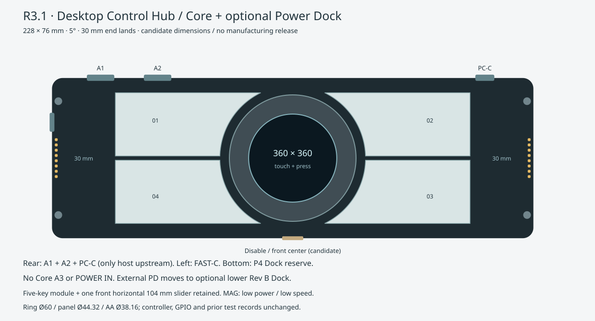
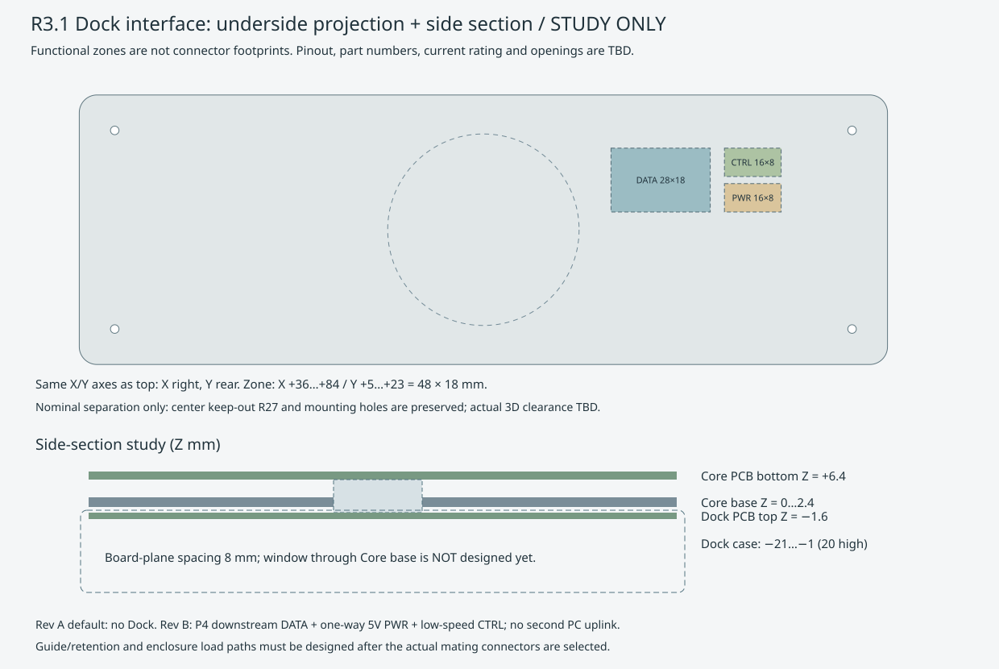

# R3.1 Core与可选下置Dock：机械基准

2026-10-19，全部新增尺寸为研究候选。继承R3短四键，不移动已运行实物。架构以[决策台账](../../docs/R3_1_DECISIONS.md)为准。

| 项目 | 候选值 / 固定关系 |
| --- | --- |
| Core外形 | 228×76、R5、壁厚/底厚2.4；5°，前高20、后高26.65 |
| PCB包络 | 216×64×1.6；旧孔(±104,±28)、Ø2.4，尚未装配冻结 |
| 四主体键 | 外端X=±84，Y外缘±31，凹弧R34.5，两端各30留白，键面高出0.3 |
| 感应中心 | (−65,+18)、(+65,+18)、(+65,−18)、(−65,−18)，四片镜像 |
| 环/屏/有效区 | Ø60/Ø44.32/Ø38.16；环口Ø41.76，可见边框单边1.8 |
| 屏幕托架/环下孔 | Ø49/Ø50，单边0.5运动间隙；3.5屏厚预算 |
| 按压 | 屏不随环转；0.3触发、0.6硬限位仅为待验证目标 |
| 背部 | A1 X≈−91、A2≈−64、PC-C≈+91；Core无A3和POWER输入口 |
| 左侧 | FAST-C Y≈+17，MAG-L端面保留，后伸/线束干涉待核 |
| MAG端面 | X=±114，每端8触点、2.5间距及Y=±27的Ø5磁铁；只低速低功耗 |
| 右附件 | 一字五键112×76包络，键距19.05、键帽外露9；K5 Fn为功能目标 |
| 横向Slider | 五键前部唯一位置104×22×8，有效长度目标90～96；未选定实物 |

可调键盘公头继续独立承力。固定前壁麦克风孔、扬声器声腔和总禁用保留；没有将Core右端留白改成竖条。

总禁用按最新补充布置在前侧中部，展示中心(0,−38)，实际开关与开孔待定；不更改GPIO0运行映射。五键与横条的尺寸/交互/控制器候选详见[补充方案](../../docs/R3_1_SUPPLEMENT.md)。

## 底部接口与侧剖

图使用与俯视一致的X/Y坐标，不是已完成配对引脚镜像的加工底视图。总研究区X=+36～+84、Y=+5～+23，48×18；DATA28×18，PWR16×8，CTRL16×8。区块表示功能空间，不是焊盘或实际连接器模型。

- DATA：Core Hub P4下游的USB2 D±、SuperSpeed TX/RX、地/屏蔽及端口VBUS参考。
- PWR：Dock单向向Core供5V/GND，额定电流、触点、限流与防反灌尚未冻结。
- CTRL：管理、检测、故障信号；具体I²C/UART及GPIO待定，不覆盖既有触控/麦克风引脚。
- 板平面研究间距8：Core PCB底面Z=6.4、Dock PCB顶面Z=−1.6；连接器在此空间和Core底板之间的开孔须实物配对后设计。
- 可选Dock包络20高、Z=−21～−1，底视占地暂同Core。叠装会增加整机高度，PD/散热/结构受力尚未验证。Rev A默认不画出装配实体Dock，原HTML只在展开时显示候选包络。

中央R27避让、旧孔和上述研究区仅做二维名义不重叠检查；不是3D干涉通过。普通EC11本体不能放屏幕中心，侧置传动或环形检测未定。Rev A板框放行前必须确定完整DATA/PWR/CTRL配对件、堆叠高度和开孔。

## 文件与边界

[参数JSON](interface-parameters-r3-1.json) · [机械/SVG生成器](tools/update_r3_1.py) · [OpenSCAD草模](sources/body-r3-1.scad) · [工程评审](../../docs/R3_1_ENGINEERING_REVIEW.md)。

草模新增`show_dock`、`dock-envelope`、`dock-interface-study`和`section-study`。这些不是已加工装配零件，未执行OpenSCAD实体编译/导出验证。原[R3尺寸](dimensions-r3.md)、R3 JSON、SCAD、SVG及KiCad载板保留历史；本轮不通过运行旧生成脚本覆盖它们。
