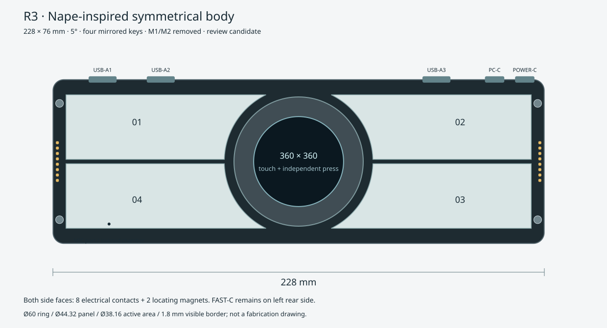

# R3：参考 Nape Pro 的对称长条主体

2026-10-17。单位 mm，状态为新布局与建模草案。R2 保留为历史；本页采用用户最新要求，去掉 M1/M2，并以四键对称替代 R2 的左小右长。固件四键编号与功能不变。

## 参考与尺寸取舍

参考 [Keychron Nape Pro 官方产品](https://www.keychron.com/products/keychron-nape-pro-wireless-trackball-mouse)的横向控制台、中央球/环与四周长按键组织。官方描述其 25 mm 轨道球、6 个自定义键及控制环；这里移除用户指定的 M1/M2，只保留四键。没有复用其电子板、ZMK 工程或内部 CAD，也不推断其未公开内部结构。

本项目使用现有 Ø44.32 屏体和 Ø60 外旋转环，按实际零件重排外壳，而非把实物屏幕等比例拉大。主体采用 **228×76，长宽比 3:1**。深度由 Ø60 圆环、壳体边距及接口空间约束，不压到无法装屏的宽度。

## 统一坐标与结构

屏幕圆心 O=(0,0)，X 向右、Y 向背部、Z 向上。机壳范围 X=±114、Y=±38。左右、前后键面均镜像。

| 项目 | R3 候选值 |
| --- | --- |
| 外壳 | 228×76，R5，壁厚/底厚 2.4 |
| 顶面 | 5°，前缘 20、后缘约 26.65，不含外环与脚垫 |
| 主板 | 216×64×1.6；四孔 (±104,±28)，孔径 2.4 |
| 四键 | 矩形区域 X=±1～±108、Y=±1～±31，减去同心 R34.5；四片面积相同 |
| 键面高度 | 高出面板 0.3，上限仍为 1；内部支撑不靠玻璃承力 |
| 感应中心 | (−65,+18)、(+65,+18)、(+65,−18)、(−65,−18)；这是 R3 新布局，未移动旧实物 |
| 屏体 / AA | Ø44.32×3.5 安装预算 / Ø38.16 |
| 外环 | Ø60，开口 Ø41.76，AA 到开口单边 1.8 |
| 屏幕托架 | Ø49，环下孔 Ø50，单边运动间隙 0.5 |
| 外环 / 玻璃 | 环高出面板 8，玻璃低于环顶约 1.8 |
| 按压 | 屏幕不随环转动，沿 Z 独立触发；0.3 触发行程、0.6 硬限位仍为待验证目标 |

长键面需要多点导向或弹性承托；普通开关可先验证输入，后续 eFlesh 仍需独立标定，不能假定一个感应点覆盖整片长键。屏幕背板、FPC 弯折和真实厚度仍须核对。

## 模块拆分

| 模块 | 结构与功能 | 当前交付 |
| --- | --- | --- |
| M-A 主体底壳 | 支柱、螺丝、侧面磁吸定位、前侧麦克风孔 | OpenSCAD 参数化草模 |
| M-B 顶框与四键 | 四个镜像长键，低外露高度，可单独拆换 | 草模 + 俯视轮廓 |
| M-C 旋转环 | 支撑、抗抬起、编码器传动；只旋转 | 环唇/包络草模，轴承和传动未定 |
| M-D 屏幕按压组件 | 周边托架承力、三点支撑、导向防转、弹性复位、硬限位 | 托架草模；弹片/开关堆叠待设计 |
| E-A 主体载板 | 接入当前开发板、显示/输入/音频模块 | KiCad 接口与布局草稿，未布线 |
| E-B 麦克风子模块 | INMP441，固定前壁声孔、独立密封声腔 | 可选固件驱动 + 逻辑接口 |
| E-C Hub/电源子模块 | 背部接口、电源保护、PC 上行与 FAST 下行 | 位置与功能预留，没有电路 |
| E-D 磁吸端面小板 | 主板至端面 90° 转接、触点、定位和保护 | 空间与网络定义，具体板未完成 |
| A-A 右侧五键 | 五个键帽、19.05 间距；帽高仍为原 9 mm | 112×76 新包络，未设计内部 PCB |
| A-B 独立触控条 | 104×22×8，位于五键模块前部，可单独拆离 | 展示包络，触控传感器未选 |

右附件深度随主体改为 76；单独主体仍是完整对称长条。五键附件装在右侧时整体自然不对称，但没有恢复被删掉的 M1/M2。

## 磁吸、电气触点与接口

两端 X=±114 均保留触点面。每侧 8 点，Y=−8.75～+8.75、2.5 间距；磁铁 Ø5 位于 Y=±27，定位件独立承受侧向力。主板顶面连接焊盘通过约 8 mm 过渡区与独立端面小板连接，不把 PCB 平面焊盘直接当成已实现的侧面 pogo。

触点拟分配受保护 5V、GND、隔离 3V3、SDA、SCL、DET、INT、GND。限流、防反接、热插拔总线隔离及接触电流需选型后实现；PCB 这些网络目前 DNP/悬置，**没有将附件直接接到现有触控 I²C 或电源**。高速 USB 不走这些触点。

背部保留 USB-A×3、PC-C、POWER-C，左侧 FAST-C 的 Y=+17，避开中央触点和上侧磁铁。USB-A 的 X=−91/−64/+64，PC-C 为 +91，POWER-C 为 +105，仅为包络布局。键盘仍使用独立承载的可调 Type-C 公头，不将公头焊死在主板边缘或让键盘母口承受主机重量。

麦克风孔在固定前侧壳壁 (X=−88,Y=−38,Z≈9)，不在活动按键上；扬声器宜放右侧另一腔体。全向麦克风仍需正确声孔、密封和减振，不能解决自身扬声器回声。

## 源文件与验证边界

[参数 JSON](interface-parameters-r3.json) · [OpenSCAD 草模](sources/body-r3.scad) · [PCB 说明](../pcb/sources/body-r3/README.md) · [原HTML更新后的交互展示](../../design/visualization/hairline-keyboard-hub.html)。

OpenSCAD 可按 part 输出底壳、顶框、环、托架或键面。当前环境未安装 OpenSCAD，因此没有编译/导出 STL 或验证实体布尔运算。草模用于继续细化，不是可直接打印并保证装配的零件。没有实际轴承、EC11 传动、屏幕背板、Hub 或磁吸连接器封装时，不能宣布整机堆叠完成。
