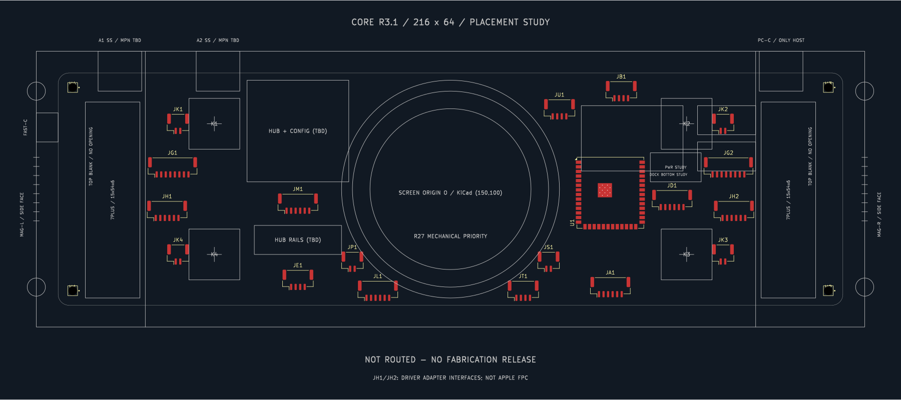

# 7 Plus马达：原生机械布局及检查

2026-10-22。通过Konnect MCP修改并保存用户指定的Pc-Hub板图，随后读回和导出。此快照是新控制电路同步前的机械布局，**尚未接网/布线，DRC未通过，不是生产文件**。

- [完整SVG](pcb-layout.svg)、[裁切预览SVG](pcb-preview.svg)：KiCad原生导出，仅裁去页面空白并添加暗色底。
- [23个封装坐标](placement.csv)、[验证记录](verification.json)：实时IPC读回；23封装及50机械图元，未将设计请求当作读回证据。
- [DRC报告](drc.json)：已明确同步保存实时板图后运行，12错误、38警告；报告未截断。

已更新两侧15×54马达装配投影、电源选择候选区及三处文字。JH1/JH2为(±78,−6)，JG1/JG2为(±76.5,+6)；其余封装、圆心和孔位保持原位。Dwgs.User仍是机械参考线，不自动执行器件高度或铜层禁布约束。

12项错误为原模组封装0.2 mm热孔与旧工程0.3 mm最小孔规则冲突；38警告包含旧原理图差异29项及库/丝印问题9项。未通过修改孔径或放宽旧规则掩盖问题。尚无新电气网络，`unconnected_items=0`不等于已连线。

只读布局检查以IPC为源、未发现庭院重叠；因圆角板框无法由该工具证明包含关系，结果为`outline_unproven`，分数100不是通过结论。原生工程位于用户指定KiCad目录；固件没有修改或烧录。

[机械依据](../../references/core-haptic-placement-r3-1.md) · [马达接线来源](../../../../docs/haptic-iphone-7-plus.md) · [主板集成/安装分工](../../../../docs/core-integration-and-mounting-rev-a.md)。
