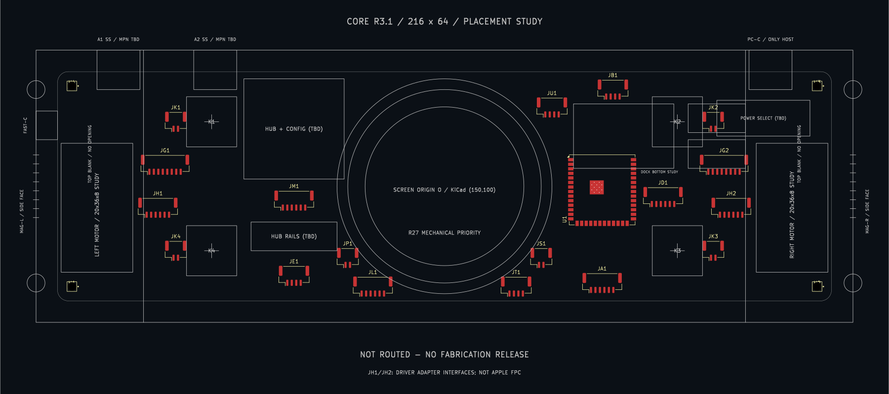

# Core R3.1 马达预留：实际 KiCad 布局导出

2026-10-19。**布局草案，未接网、未布线、DRC未通过，不可用于制造或通电。**

历史快照：本目录保留10月19日旧20×36×8预留。当前已锁定[iPhone 7 Plus](../../../../docs/haptic-iphone-7-plus.md)，最新15×54×6方案及10月22日实际改板/新DRC见[7 Plus原生导出](../core-r3-1-7plus-study/README.md)。

- [原始KiCad导出SVG](pcb-layout.svg)：Edge.Cuts、F.Cu、F.SilkS、Dwgs.User；由Konnect MCP调用KiCad导出。
- [裁切预览SVG](pcb-preview.svg)：只裁去页框空白；板内图形来自原生导出。
- [放置坐标CSV](placement.csv)、[读回与检查记录](verification.json)：来自MCP实时读回，不以设计请求代替实际结果。
- [完整DRC JSON](drc.json)：已同步保存的板图快照；12项错误、38项警告，共50项。无未连线项不代表已连接，当前新增焊盘没有分配网络。

当前23个封装：1个ESP32模组、18个候选接口、4个安装孔；H1同时承载50个机械参考图元。USB3插座、Hub和电源只保留功能区，尚无完整原理图和供电电路。继承的两层设置尚未转换为最终高速板叠层。

12项错误来自U1库封装的0.2 mm热孔小于原工程0.3 mm最小孔径限制；没有通过放宽规则或改小孔径来掩盖。38项警告包括29项与旧原理图的差异、8项丝印问题、1项U1库一致性问题。连接器已经过MCP的库同步；U1同步因工具不支持库中unlocked用户文字而拒绝，未强行改库。完整电气设计前这些问题都必须处理。

机械包络是Dwgs.User图形，不是自动执行的铜层禁布区，也不证明苹果马达实物能装入。工作工程在用户指定目录：

`C:\Users\indeg\OneDrive\文档\KiCad\10.0\projects\Pc-Hub\Pc-Hub\Pc-Hub.kicad_pro`

旧原理图保持原状，与当前板图不匹配；旧工程完整备份在同目录`backups/before-core-haptic-20261019-222132/`。后续不能用旧原理图直接更新新PCB。

[尺寸和结构依据](../../references/core-haptic-placement-r3-1.md) · [用户要求的安装示意](../../../../design/drawings/haptic-reservation-r3-1.png)。
