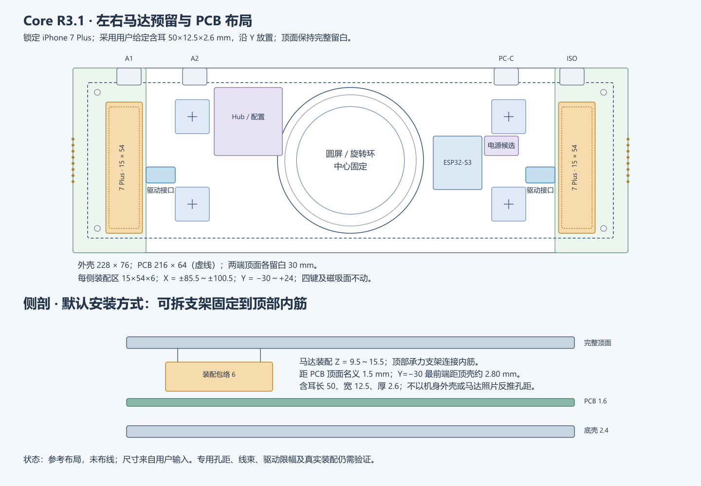

# Core R3.1：7 Plus马达预留与PCB位置

2026-10-22。当前唯一目标为iPhone 7 Plus，取代13 Pro/13 Pro Max。本文修订10月19日预留方案；参考图已更新，原生改板状态见[执行记录](haptic-7plus-native-update.md)。**新板尚未建立完整原理图、网络连接和铜线，不能打样或通电。**

2026-10-31新增[最右侧ISO／DEBUG接口](../../../docs/iso-debug-r3-1.md)后，本马达预留X=85.5～100.5与新插座中心X≈+91重叠。当前马达预留和背部端口均是候选，未完成插座深度/Z向/后孔实体核对；[新干涉图](../../../design/drawings/iso-debug-rear-study-r3-1.svg)优先于本页旧后口位置。不得把两者直接叠加成可制造布局。

## 坐标及结构

产品原点是圆屏圆心O，X右、Y背部、Z向上；KiCad映射`Xpcb=150+X`、`Ypcb=100−Y`，单位mm。沿用228×76外壳、216×64×1.6候选主板、5°顶面、前高20、壁厚2.4。

| 项目 | 当前设计值 |
| --- | --- |
| 两端顶面留白 | X=−114～−84、+84～+114；各30宽，表面不新增内容 |
| 马达含耳外形 | 50×12.5×2.6，采用用户输入；非项目实测或苹果机械图 |
| 长轴方向 | 产品Y轴；不据此推定内部振动方向 |
| 左总装区 | X=−100.5～−85.5、Y=−30～+24、Z=9.5～15.5 |
| 右总装区 | X=+85.5～+100.5、Y=−30～+24、Z=9.5～15.5 |
| 总包络 | 每侧15×54×6；包含支架、绝缘、焊点与线束，实际折弯仍须核验 |
| PCB层高 | 底Z=6.4、顶Z=8；总装与板顶名义间隙1.5 |
| 顶部净空 | Y=−30处顶壳内面Z≈18.300；总装顶至内面≈2.800，未扣公差 |
| 安装孔 | (±104,±28)，Ø2.4候选；孔中心至槽外侧3.5 |
| JH1/JH2 | 已移到(−78,−6)/(+78,−6)，KiCad(72,106)/(228,106) |
| JG1/JG2 | 已移到(−76.5,+6)/(+76.5,+6)，KiCad(73.5,94)/(226.5,94) |
| 电源选择研究区 | X=55～69、Y=2～10；移出旧右端投影，器件装配未冻结 |

旧20×36×8区不能放入50长外形，现作废。新槽与按键外缘相隔1.5、与磁吸端面相隔13.5、后缘至后侧USB研究区3。前孔、真实FAST-C后伸、排线、MAG竖板和天线仍需实体校核。参考线不是自动禁布区，槽内不放高器件或向上伸出的焊脚。

默认可拆托片连接顶部内筋，夹住安装耳传力，顶面不打穿；侧壁支架作备选。不猜苹果孔距，不压马达薄盖。板下只有4 mm名义净高，不把6 mm总装塞入板下。圆屏、中央R27机构区、四个(±65,±18)感应中心及Dock三分区不移动。

## 电路接口

完整来源与针序见[7 Plus接线说明](../../../docs/haptic-iphone-7-plus.md)。采用公开改装中的六测试焊盘最外侧两点引出线圈，接DRV2605L的OUT+/OUT−；均不接GND，不用未知原机FPC针序，不由GPIO直接供电。DRV2605L仍需实物限幅与校准验证。

JH1/JH2为六针JST GH候选接口，非苹果插座：1受保护3.3V、2GND、3SDA、4SCL、5使能预留、6NC。现有焊盘未接网；针序是新线束设计，非市售模块即插即用。单驱动共享GPIO8/9；双驱动需隔离同地址。默认驱动优先集成PCB，JH仅保留转接/调试用途；两根马达线另由输出座引出，不能误接JH控制座。MAX98357A和旧音频固件保留，非默认马达驱动。

JH移位后GH6庭院至长槽约1.52；JG移位后GH8庭院至长槽约1.77。只移动内部线束座，不移动外侧触点。电源14×8研究区不保证电源选择、限流和稳压全部装下，后续按具体料号展开。

## 工程记录

10月19日已通过Konnect建立216×64板框、23个封装及H1携带50个机械图元：ESP32-S3-WROOM-1U、18个候选接口、4安装孔。旧CN7/CN10原理图未替换，不从它直接更新PCB；旧网名不代表新接口接通。JS1是未来屏幕按压预留，GPIO未分配；JE1沿用编码器按压，不能同时算作两个独立GPIO39。

10月19日[DRC与原生导出](../exports/core-r3-1-haptic-study/README.md)是历史、未通过；本次执行状态另记。[机械JSON](../../enclosure/haptic-reservation-r3-1.json) · [SVG](../../../design/drawings/haptic-reservation-r3-1.svg) · [绘图源码](../../../design/drawings/generate_haptic_layout_r3_1.py)。生成器只写参考SVG/JSON，所有原生KiCad及库写入经Konnect MCP。
