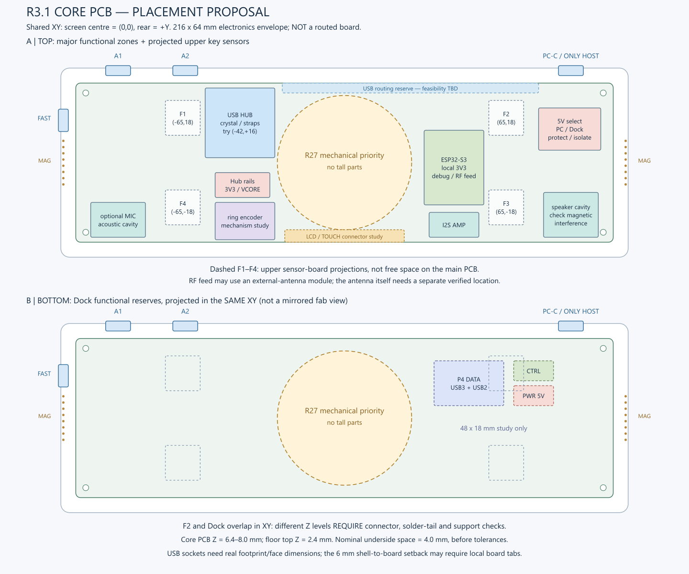

# R3.1 Core PCB：具体分区与安装层建议

2026-10-19。以main的f7e1ca2、[最新决策](../../../docs/R3_1_DECISIONS.md)、[机械基准](../../enclosure/dimensions-r3-1.md)为依据。本文新增的是下一步布局建议，不是冻结的元件坐标或已经修改的KiCad板图。没有运行旧生成器、修改受保护KiCad文件或更改固件。

## 1. 分板结论

Core优先采用一块原生主板，集成Hub、ESP32-S3模组、电源选择、小功率稳压、显示/音频接口。避免把每个功能做成长线相连的子板，尤其不把10Gbps链路变成杜邦线或普通FFC。四键传感器暂以可更换小板/接口处理；MAG端面、可调键盘公头、五键、Slider保留机械上必需的独立板。下置Dock是独立Rev B主板，承载其扩展Hub、PD受电、功率转换和保护，不把这些搬回Core。

六个逻辑下游保持P1=A1、P2=A2、P3=FAST、P4=Dock、P5=键盘、P6=ESP32。Hub要有不等待ESP32命令的配置/复位路线；保持ESP32复位时验证基础USB通路。USB7206C仍是候选，不凭逻辑端口数冻结其供电模式。

## 2. 坐标与板框

圆屏圆心O=(0,0)，X向右、Y向背部。Core外壳X=±114、Y=±38；主板216×64包络X=±108、Y=±32，厚1.6。下面的矩形是功能分区，不是某个芯片的封装或允许占满的面积。

216×64不能直接等同最终板框：主板每侧比壳体接口面内退6 mm，必须核对USB座从焊盘、屏蔽壳到插拔面的实际尺寸。优先用主板局部舌板/合理板边延伸配合真实插座；必要时才增加受控阻抗的专用高速接口板。现有四孔(±104,±28)、Ø2.4继续作候选，不能穿入插座焊尾或屏蔽壳。

| 功能 | 建议XY位置，mm | 安装层 / 约束 |
| --- | --- | --- |
| A1、A2 | 壳体背面约(-91,+38)、(-64,+38) | 主板边缘直装优先；ESD靠插座，电源开关近端口 |
| PC-C唯一上行 | 背面约(+91,+38) | CC Sink、SS翻转、ESD、独立VBUS检测；不可用Dock 5V伪造在线 |
| FAST-C | 左端面约(-114,+17) | 下游Source/翻转/限流；检查与MAG、Y=+27磁铁和左后孔的实体间距 |
| Hub+晶振/配置 | X=-56～-28，Y=+2～+30；芯片先试约(-42,+16) | 主板顶面，靠左侧外设；晶振/去耦/配置紧靠芯片，物理引脚方向可调整 |
| Hub低压稳压 | X=-52～-30，Y=-14～-4 | 主板顶面；3.3V/约1.15V按厂商供电设计，不把电感开关节点靠到麦克风或传感器 |
| ESP32+本地3.3V/调试 | X=+32～+56，Y=-17～+13 | 主板顶面，中部偏右；若此位置保留，优先研究外接天线模组，不能把板载天线闷在板中央 |
| PC/Dock电源选择 | X=+78～+103，Y=+5～+22 | 主板顶面，靠PC输入与底面PWR；两输入限流、防反灌、硬件选择，额定值待功耗实测 |
| 四键感应位置 | (-65,+18)、(+65,+18)、(+65,-18)、(-65,-18) | 上层对位小板/接口；图中14×14仅沿用研究包络，不是所选传感器封装 |
| 屏幕与触控接座 | 中央前侧X=-24～+24，Y=-32～-27研究带 | 接座形状/落点服从真实屏背及FPC折弯，低矮；避开前侧总禁用开关后伸 |
| 环编码器侧置研究 | X=-52～-28，Y=-31～-16 | 只是机构研究空间；不冻结EC11、齿轮、轴距或传动比，不占圆心 |
| 可选麦克风 | X=-102～-80，Y=-30～-16 | 固定前壁声孔附近、独立声腔；INMP441模块尺寸/声孔朝向仍需核对 |
| I²S功放 | X=+34～+54，Y=-30～-20 | 主板顶面、靠扬声器；桥接输出成对走线，不接地 |
| 扬声器腔 | X=+80～+102，Y=-30～-12 | 壳体空间，不是PCB封装；不能压到模组或天线，需验证对磁传感四键的偏置/串扰 |
| 两端MAG | 壳体X=±114，8点与磁铁沿原坐标 | 独立竖向端面小板，主板以低速连接；不能将顶面焊盘当侧向弹簧触点 |
| 键盘公头 | 原独立可调支架 | 主板留USB2/受保护5V的连接接口，公头不固定在大板上 |
| 总禁用 | 前壁约(0,-38) | 独立小开关/小板对准外壳；沿用GPIO0时必须考虑上电按住的启动绑带行为 |

这套分区保留两端30 mm固定壳面，但“上表留白”不意味着下方完全空置；声腔、转接和固定结构可利用，仍需避开天线/触点与机械承力件。

## 3. 中央与上下安装层

中央R27是机构优先区：托架、轴承/环传动、按压导向、限位和排线先占位；不放Hub、主控模组、电感或高连接器。它不是要求所有铜层挖空，也没有证明整圆需要切掉PCB。主板可否保留低矮走线、局部元件或必须开窗，须由真实机构高度决定。

当前研究Z基准：底壳底面0，底板厚2.4，Core PCB底面6.4、顶面8.0；底面至底板上表面名义只有4.0 mm，再扣公差和绝缘。不要因此把高连接器、模组或电感翻到底面。四键上层感应板Z≈16～17.6仍只是旧分层研究值，须按真实键支撑校核。

**右上感应位(65,18)与底部Dock投影重叠。** 这可以成为不同Z层的叠放方案，但不代表已有3D净空：须同时检查主板底面连接器、顶面焊点/通孔、上层小板、按键导柱和螺钉。优先研究底面SMT对接件；若用通孔结构，必须把穿透板面的焊脚高度计入。

## 4. 底部Dock分区

保持当前研究区，不因普通MAG方便而改用MAG传高速或全机电流：

| 分区 | XY范围 | 设计职责 |
| --- | --- | --- |
| DATA | X=36～64，Y=5～23 | Core P4的USB3+USB2、地/屏蔽与端口VBUS参考；不是第二电脑上行 |
| PWR | X=68～84，Y=5～13 | Dock→Core受保护5V与GND，反向截止和接触额定待核 |
| CTRL | X=68～84，Y=15～23 | 检测/状态/故障管理，接口与GPIO待定，避免掉电反供 |

三块矩形不是选定连接器焊盘。Core底面与Dock顶面8 mm的研究间距还穿过Core底板/开孔，必须完整配对件、定位柱和结构锁定一起设计；20 mm Dock高度不作实物保证。

Dock自己的PCB按对接DATA位置布置扩展Hub，PD入口/保护/降压围绕Dock外侧边缘与散热结构布置；电源输出端靠PWR对接区。Dock端口数量、PD档位、额定瓦数和实际板框尚未冻结，不能复用旧单体100W/46W预算。

## 5. 布线与射频策略

建议首块原生Core研究六层：L1器件/高速、L2连续地、L3电源、L4低速、L5连续地、L6底面短高速/器件；这是一项实现建议，不是USB7206C统一强制层数。板厂叠层和差分阻抗计算完成后才设线宽线距，不先给一个通用mil数。

保留中央后侧Y≈+28～+32的高速绕行走廊，优先研究PC-C到左侧Hub的路径；必要时用其他参考地连续的层分流。这个4 mm走廊不是“已够宽”证明，长距离上行和P4下行的插损/过孔/连接器预算决定能否成立；若不满足，先微调Hub落点，再重新讨论端口位置，不自动增加重定时器。

屏幕QSPI从右侧MCU走中央前侧短路径，I²S去右前功放，麦克风在左前。分区但不随意切割地平面；USB和时钟不能跨地缝。端口ESD靠入口、Hub晶振靠芯片；音频大电流与稳压开关节点不绕传感/麦克风一圈。

模组若使用板载PCB天线，必须转移到适合板边且有真实净空的位置，不能在本文MCU区原地挖一圈铜就算合格；若维持中部偏右位置，则优先研究外接天线版本，将天线另置于满足净空的塑料区域。右端有MAG/磁铁，下方可能有Dock，因此天线落点仍需整机RF校核。

## 6. 当前结论与来源

可以采用的是以上功能邻接、上下分面、现有外壳/感应基准和Dock三分区；不能据此宣布PCB放行。先完成Core单线峰值/Hub供电配置，屏背/FPC与环传动，USB/完整Dock连接器和模组天线方案，再做KiCad真实封装布局、ERC/DRC与高速/装配评审。

依据：[USB7206C资料](https://www.microchip.com/content/dam/mchp/documents/NCS/ProductDocuments/DataSheets/USB7206C-Data-Sheet-DS00003850.pdf)、[Microchip硬件检查表](https://www.microchip.com/content/dam/mchp/documents/UNG/ProductDocuments/DesignChecklist/USB7206C-Hardware-Design-Checklist-DS00003336.pdf)、[Espressif布局与天线要求](https://docs.espressif.com/projects/esp-hardware-design-guidelines/en/latest/esp32s3/pcb-layout-design.html)。仓库状态以[工程评审](../../../docs/R3_1_ENGINEERING_REVIEW.md)为准；本图是研究建议，不替代它。
